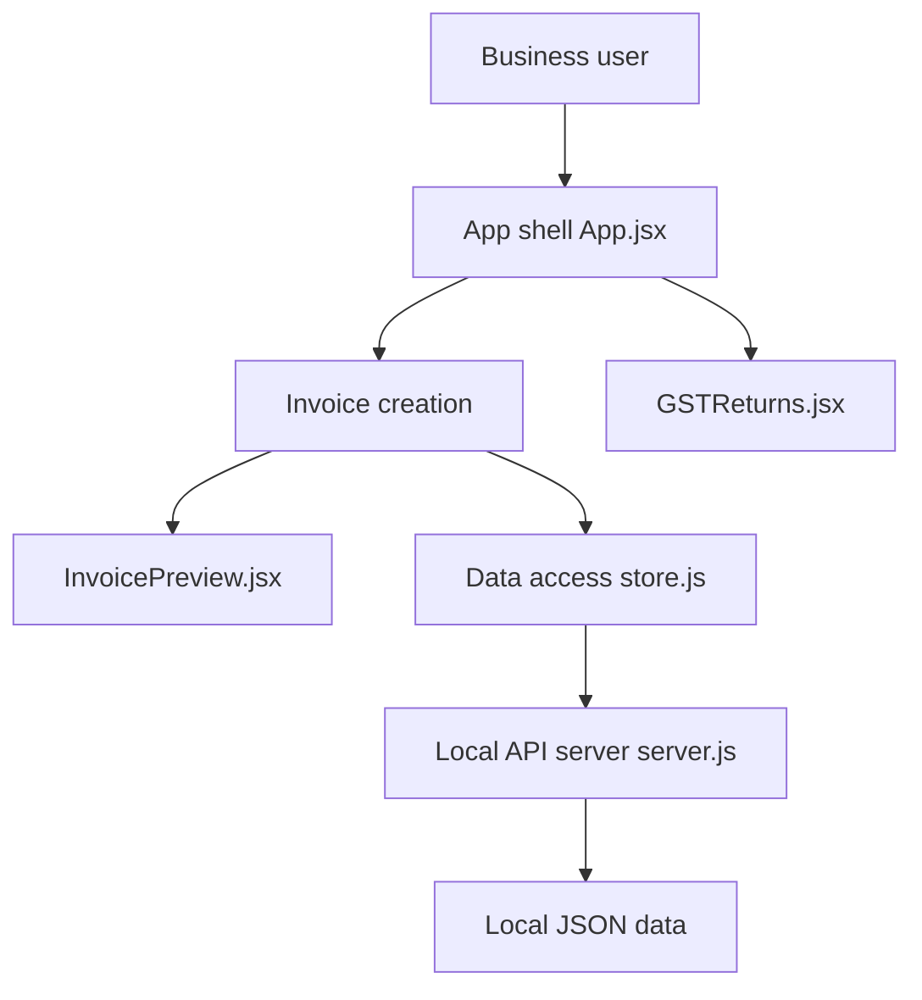

# IamRamgarhia/Free-GST-Billing-Software

> Free, local, offline GST billing software for small Indian businesses.

## The problem
Indian billing software (Tally, Vyapar, Zoho) is paid and hosts your data on their side.

## What it actually does
A React application with a local Node server (`server.js`, localhost:47371) that stores everything in JSON files. It issues invoices, quotes, credit notes and delivery challans as PDFs, computes CGST/SGST/IGST/UTGST, exports GSTR-1 and GSTR-3B, reconciles 2B, handles TDS/TCS, stock, expenses, 22 currencies and an ITR module. Automatic daily backup. Offline mode disables the update check and the list of supporters; Google Drive is optional. The README provided is truncated at the end.

## How it is wired


## Trying it
```bash
powershell -ExecutionPolicy Bypass -c "[Net.ServicePointManager]::SecurityProtocol='Tls12'; irm https://raw.githubusercontent.com/IamRamgarhia/Free-GST-Billing-Software/main/install.ps1 | iex"
```
Or download the release ZIP, extract it, and run your system's launcher.

## Cost and gotchas
Free. Installs Node.js if missing. The server has no authentication: the author advises against hosting it online. Installing via `irm | iex` runs a remote script.

## What it is not
Not a multi-user or hostable solution. The comparison tables with Tally and Zoho are self-declared, with no independent verification.

## Alternatives
The README cites Tally, Vyapar, Zoho Books, ClearTax and myBillBook (paid).

## For you
Ignore: Indian tax invoicing unrelated to your data / AI / MLOps work, useful only if you invoice in India.
