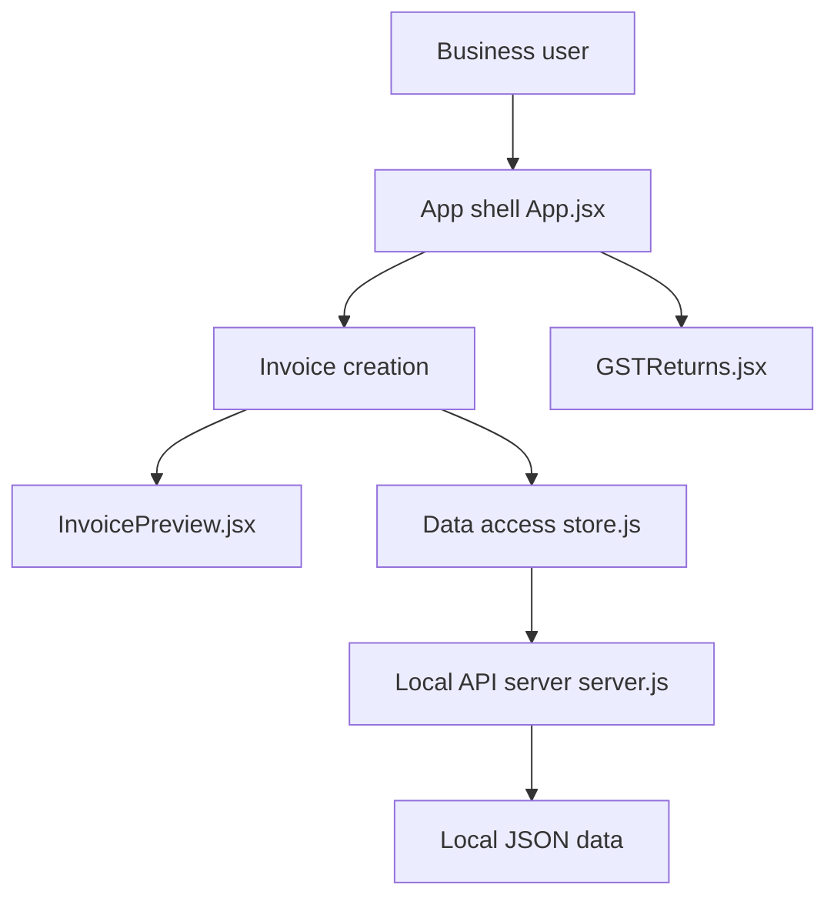

# IamRamgarhia/Free-GST-Billing-Software

> Logiciel de facturation GST gratuit, local et hors ligne, pour petites entreprises indiennes.

## Le problème
Les logiciels de facturation indiens (Tally, Vyapar, Zoho) sont payants et hébergent les données chez eux.

## Ce que ça fait vraiment
Une application React avec serveur Node local (`server.js`, localhost:47371) qui stocke tout en fichiers JSON. Elle émet factures, devis, avoirs et bons de livraison en PDF, calcule CGST/SGST/IGST/UTGST, exporte GSTR-1 et GSTR-3B, rapproche la 2B, gère TDS/TCS, stock, dépenses, 22 devises et un module ITR. Sauvegarde quotidienne automatique. Le mode hors ligne coupe contrôle de mise à jour et liste des soutiens ; Google Drive est optionnel. Le README fourni est tronqué en fin de document.

## Comment c'est branché


## Essayer
```bash
powershell -ExecutionPolicy Bypass -c "[Net.ServicePointManager]::SecurityProtocol='Tls12'; irm https://raw.githubusercontent.com/IamRamgarhia/Free-GST-Billing-Software/main/install.ps1 | iex"
```
Ou télécharger le ZIP de la release, l'extraire, lancer le lanceur de ton système.

## Coût et pièges
Gratuit. Installe Node.js si absent. Le serveur n'a pas d'authentification : l'hébergement en ligne est déconseillé par l'auteur. L'installation via `irm | iex` exécute un script distant.

## Ce que ce n'est pas
Pas une solution multi-utilisateur ni hébergeable. Les tableaux comparatifs avec Tally et Zoho sont auto-déclarés, sans vérification indépendante.

## Alternatives
Le README cite Tally, Vyapar, Zoho Books, ClearTax et myBillBook (payants).

## Pour toi
À ignorer : facturation fiscale indienne sans lien avec ton travail data / IA / MLOps, utile uniquement si tu factures en Inde.

