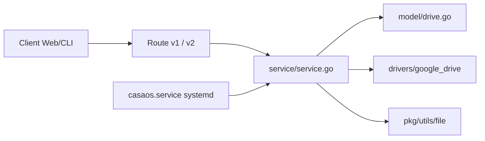

# IceWhaleTech/CasaOS

> Personal-cloud web layer for installing Docker apps on a home server.

## The problem
Managing a home server (Nextcloud, Jellyfin, Home Assistant) from the command line puts off non-technical people.

## What it actually does
A Go service installed by script on Debian, Ubuntu or Raspberry Pi OS: web interface, one-click Docker app store, disk and file management, resource widgets. Drivers for Dropbox, Google Drive, OneDrive. API described in OpenAPI, systemd service.

## How it is wired


## Trying it
```bash
curl -fsSL https://get.casaos.io | sudo bash
casaos -v
casaos-uninstall
```

## Cost and gotchas
Installed via `curl | sudo bash`. Last push in August 2025, over a year ago: uncertain maintenance, 834 open issues.

## What it is not
Not a full OS nor an orchestrator; nothing AI-specific despite the mention of a "personalized copilot".

## Alternatives
None named in the README.

## For you
A personal cloud for a home server: useful for a homelab, no contribution to a data or MLOps chain. To ignore.
