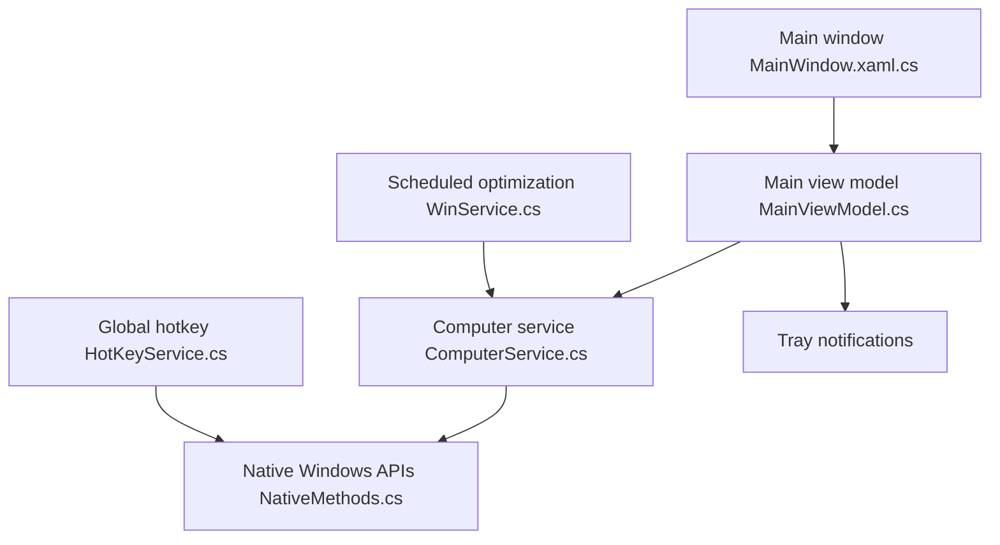

# IgorMundstein/WinMemoryCleaner

> Small Windows utility that frees RAM through native APIs, with a UI, tray and console mode.

## The problem
On Windows, cached memory (the Standby list) or memory held by processes can slow down a PC with little RAM.

## What it actually does
It calls documented Windows APIs to flush eight areas: Working Set, Standby List, Modified Page List, file and registry caches, etc. It offers automatic optimization by interval or threshold, a global hotkey, an exclusion list, a Windows service and console arguments. Settings are stored in the registry. It requires administrator rights.

## How it is wired


## Trying it
```cmd
winget install IgorMundstein.WinMemoryCleaner
{path}\WinMemoryCleaner.exe /ModifiedFileCache /StandbyList /WorkingSet
{path}\WinMemoryCleaner.exe /Install
```

## Cost and gotchas
Free, GPL-3.0. Administrator rights, registry entries and a scheduled task: antivirus software often flags it wrongly, according to the README.

## What it is not
No guaranteed gain on a recent PC with plenty of RAM. Windows only, no link with AI or MLOps.

## Alternatives
- RAMMap (Microsoft Sysinternals): detailed analysis, with some similar cleaning functions.
- Process Explorer: see which processes consume.

## For you
Ignore: a Windows utility unrelated to your line of work, and the memory gain remains debatable.
