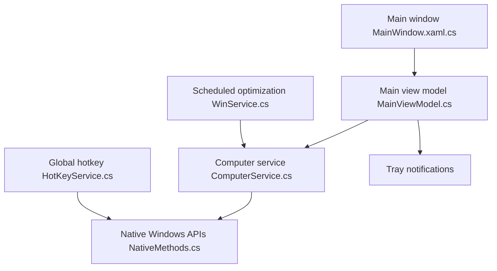

# IgorMundstein/WinMemoryCleaner

> Petit utilitaire Windows qui libère la RAM via les API natives, avec interface, tray et mode console.

## Le problème
Sous Windows, la mémoire cache (liste Standby) ou retenue par des processus peut ralentir un PC à peu de RAM.

## Ce que ça fait vraiment
Il appelle des API Windows documentées pour vider huit zones : Working Set, Standby List, Modified Page List, caches fichiers et registre, etc. Il propose optimisation automatique par durée ou seuil, raccourci global, liste d'exclusion, service Windows et arguments console. Les réglages sont dans le registre. Il exige les droits administrateur.

## Comment c'est branché


## Essayer
```cmd
winget install IgorMundstein.WinMemoryCleaner
{path}\WinMemoryCleaner.exe /ModifiedFileCache /StandbyList /WorkingSet
{path}\WinMemoryCleaner.exe /Install
```

## Coût et pièges
Gratuit, GPL-3.0. Droits administrateur, entrées de registre et tâche planifiée : les antivirus le signalent souvent à tort, selon le README.

## Ce que ce n'est pas
Pas un gain garanti sur un PC récent bien doté en RAM. Windows uniquement, aucun lien avec l'IA ou le MLOps.

## Alternatives
- RAMMap (Microsoft Sysinternals) : analyse détaillée, avec quelques fonctions de nettoyage similaires.
- Process Explorer : voir quels processus consomment.

## Pour toi
À ignorer : utilitaire Windows sans rapport avec ton métier, et le gain mémoire reste discutable.

