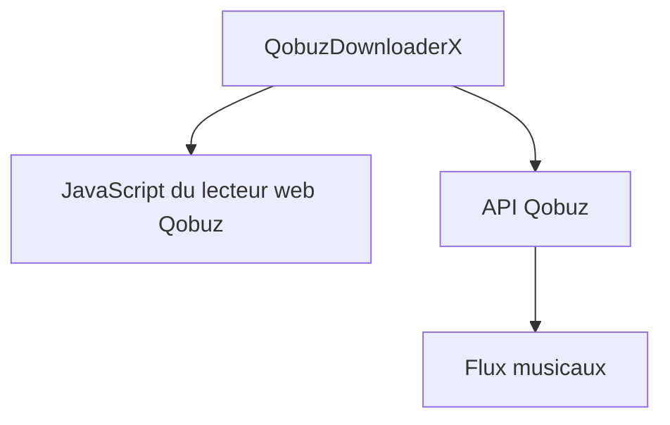

# ImAiiR/QobuzDownloaderX

> Program that downloads music streams from Qobuz, for subscribers to the service.

## The problem
Getting the music of a streaming subscription offline.

## What it actually does
The README says almost nothing about it: it states that a free account allows no downloads. It specifies that the tool contains neither a bypass of regional restrictions nor Qobuz application credentials, and that it extracts them client-side from the web player's public JavaScript.

## How it is wired
Simplified diagram based on the fiche, no diagram provided.

## Trying it
No command is documented in the README.

## Cost and gotchas
A paid Qobuz subscription is required. The author disclaims all responsibility for use. No license declared, and operation depends on the Qobuz site.

## What it is not
It is not a tool approved by Qobuz, and it does not work with a free account. Very thin material: the details of its features are not documented.

## Alternatives
No alternative named in the README.

## For you
Ignore: unrelated to data or AI, unlicensed, and risky with respect to a third-party service's terms.
