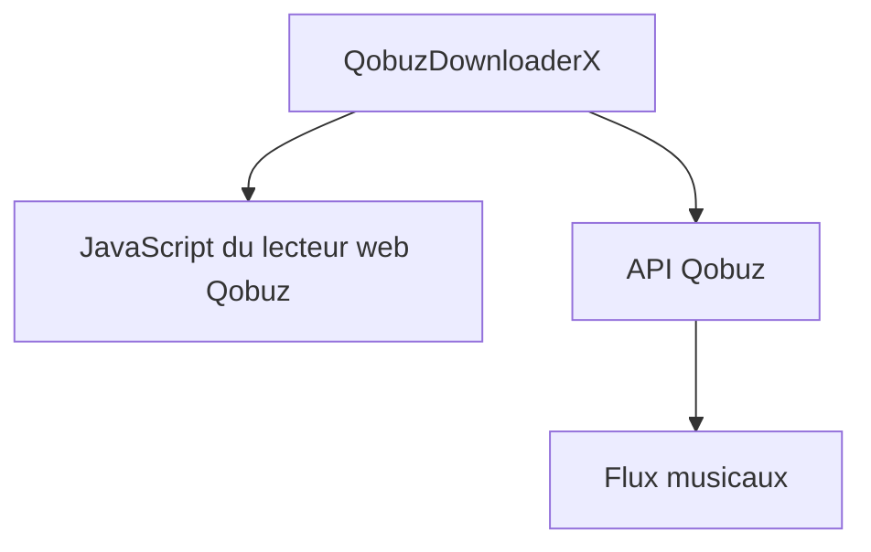

# ImAiiR/QobuzDownloaderX

> Programme qui télécharge des flux musicaux de Qobuz, pour des abonnés au service.

## Le problème
Récupérer hors ligne la musique d'un abonnement de streaming.

## Ce que ça fait vraiment
Le README n'en dit presque rien : il indique qu'un compte gratuit ne permet aucun téléchargement. Il précise que l'outil ne contient ni contournement de restrictions régionales, ni identifiants d'application Qobuz, et qu'il les extrait côté client du JavaScript public du lecteur web.

## Comment c'est branché
Schéma simplifié d'après la fiche, sans diagramme fourni.

## Essayer
Aucune commande n'est documentée dans le README.

## Coût et pièges
Un abonnement Qobuz payant est nécessaire. L'auteur décline toute responsabilité d'usage. Aucune licence déclarée, et le fonctionnement dépend du site Qobuz.

## Ce que ce n'est pas
Ce n'est pas un outil approuvé par Qobuz, et il ne fonctionne pas avec un compte gratuit. Matière très mince : le détail des fonctions n'est pas documenté.

## Alternatives
Aucune alternative nommée dans le README.

## Pour toi
À ignorer : sans rapport avec la data ou l'IA, sans licence et à risque vis-à-vis des conditions d'un service tiers.

