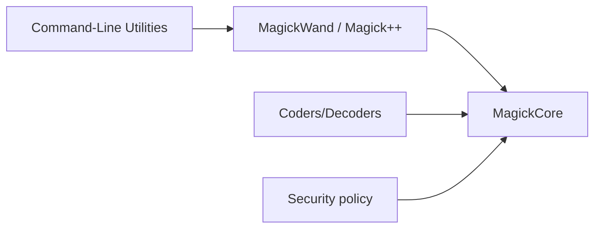

# ImageMagick/ImageMagick

> Open source C suite to create, convert and transform images from the command line or through an API.

## The problem
Processing lots of images (conversion, resizing, compositing) in a scriptable way without writing specialized code.

## What it actually does
MagickCore kernel, MagickWand API, Magick++ (C++), PerlMagick, utilities (`convert`, `identify`, `mogrify`, `montage`). "Coders" read and write formats (JPEG, PNG, GIF, TIFF, PDF…). Features: transformations, filters, DFT, perceptual hash, morphology, colors, HDR and multispectral images, large images, OpenCL/OpenMP. Defining a security policy is recommended.

## How it is wired

## Trying it
The README contains no commands: it points to the `imagemagick.org` site (examples, security policy, validation tool).

## Cost and gotchas
Free, license present but not identified by GitHub: check it. Write a security policy before using it on untrusted files.

## What it is not
Not a computer vision or machine learning tool: classic image processing.

## Alternatives
No alternative named in the README (Magick.NET is mentioned as a .NET wrapper).

## For you
Solid building block to preprocess image datasets before training; adopt, with a strict security policy.
