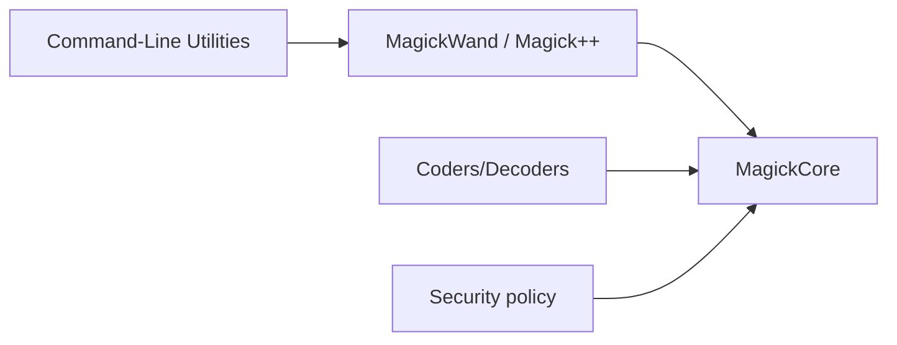

# ImageMagick/ImageMagick

> Suite open source en C pour créer, convertir et transformer des images en ligne de commande ou par API.

## Le problème
Traiter beaucoup d'images (conversion, redimensionnement, composition) de façon scriptable sans écrire de code spécialisé.

## Ce que ça fait vraiment
Noyau MagickCore, API MagickWand, Magick++ (C++), PerlMagick, utilitaires (`convert`, `identify`, `mogrify`, `montage`). Des « coders » lisent et écrivent les formats (JPEG, PNG, GIF, TIFF, PDF…). Fonctions : transformations, filtres, DFT, hash perceptuel, morphologie, couleurs, images HDR et multispectrales, grandes images, OpenCL/OpenMP. Une politique de sécurité à définir est recommandée.

## Comment c'est branché

## Essayer
Le README ne contient aucune commande : il renvoie au site `imagemagick.org` (exemples, politique de sécurité, outil de validation).

## Coût et pièges
Gratuit, licence présente mais non identifiée par GitHub : à vérifier. Écrire une politique de sécurité avant usage sur des fichiers non fiables.

## Ce que ce n'est pas
Pas un outil de vision par ordinateur ni d'apprentissage : du traitement d'image classique.

## Alternatives
Aucune alternative nommée dans le README (Magick.NET est cité comme enveloppe .NET).

## Pour toi
Brique solide pour prétraiter des jeux d'images avant un entraînement ; à adopter, avec une politique de sécurité stricte.

