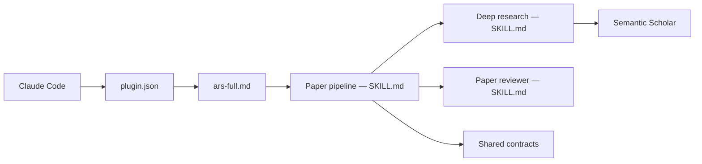

# Imbad0202/academic-research-skills

> Following Claude Code skills for researchers: literature review, writing, editing, and publication workflow.

## The problem
AI research pipelines hallucinate citations and results; there is no requirement for human oversight at each stage.

## What it actually does
Four skills: `deep-research`, `academic-paper`, `academic-paper-reviewer`, `academic-pipeline` (10 steps).
Mandatory integrity checks (steps 2.5 and 4.5), "Material Passport" for provenance.
Verification of references via Semantic Scholar, OpenAlex, Crossref; optional audit of claims.
Output: Markdown, DOCX (Pandoc) or PDF (LaTeX - tectonic); Python scripts for schema linting.

## How it is wired


## Trying it
```bash
# Commandes à taper dans Claude Code, pas dans un shell :
/plugin marketplace add Imbad0202/academic-research-skills
/plugin install academic-research-skills
/ars-plan
```

## Cost and gotchas
Anthropic Key; approximately $4 to $6 for a 15,000-word article, according to the README. Pandoc/Tectonic are optional.

## What it is not
Do not write the article for me and do not prove that the experiments were conducted. Uncalibrated results (`NOT_CALIBRATED`).

## Alternatives
- Imbad0202/academic-research-skills-codex: The same content, packaged for use with the Codex CLI.

## For you
Useful if you are writing documents; heavy and controlled by a single person.
