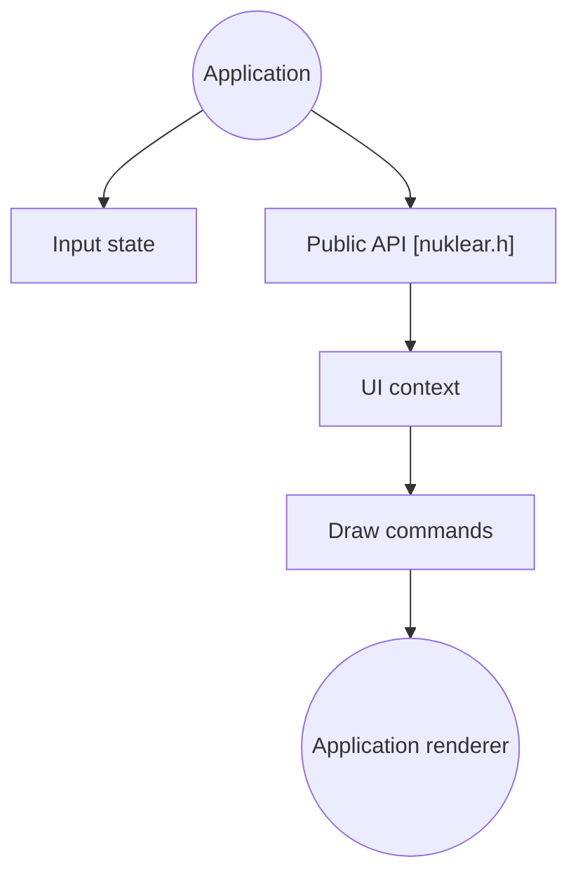

# Immediate-Mode-UI/Nuklear

> Immediate-mode, single-header graphical user interface toolkit in C, for embedding a UI in an application.

## The problem
Adding a lightweight graphical interface to a C program without depending on a large framework or an imposed rendering engine.

## What it actually does
A single C89 header file, with no dependencies. The application passes the input state on every frame, builds the interface through calls, then draws the resulting commands with its own rendering engine. GLFW, SDL, X11, GDI, Direct3D and Vulkan backends are in the demo folder.

## How it is wired


## Trying it
```bash
make -C demo/glfw_opengl3
```

## Cost and gotchas
Free. The same flags must be defined at every inclusion of `nuklear.h`, otherwise you get compilation errors or stack corruption. A C compiler is required.

## What it is not
Not a ready-made interface: it handles neither windows, nor input, nor rendering.

## Alternatives
- imgui (by Omar Cornut): cited as a source of inspiration.

## For you
Ignore: embedded UI tool in C, with no use for data/AI pipelines.
