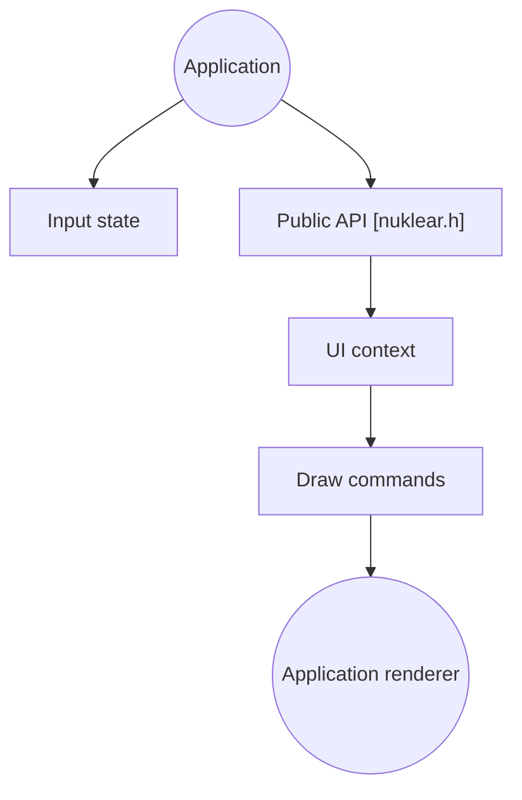

# Immediate-Mode-UI/Nuklear

> Boîte à outils d'interface graphique en C, mode immédiat, mono-en-tête, pour intégrer une UI dans une application.

## Le problème
Ajouter une interface graphique légère à un programme C sans dépendre d'un grand framework ni d'un moteur de rendu imposé.

## Ce que ça fait vraiment
Un seul fichier d'en-tête en C89, sans dépendance. L'application transmet l'état des entrées à chaque image, construit l'interface par appels, puis dessine les commandes produites avec son propre moteur de rendu. Des backends GLFW, SDL, X11, GDI, Direct3D et Vulkan sont dans le dossier demo.

## Comment c'est branché


## Essayer
```bash
make -C demo/glfw_opengl3
```

## Coût et pièges
Gratuit. Les mêmes drapeaux doivent être définis à chaque inclusion de `nuklear.h`, sinon erreurs de compilation ou corruption de pile. Un compilateur C est requis.

## Ce que ce n'est pas
Pas une interface prête à l'emploi : il ne gère ni fenêtre, ni entrées, ni rendu.

## Alternatives
- imgui (d'Omar Cornut) : cité comme source d'inspiration.

## Pour toi
À ignorer : outil d'UI embarquée en C, sans usage pour des pipelines data/IA.

