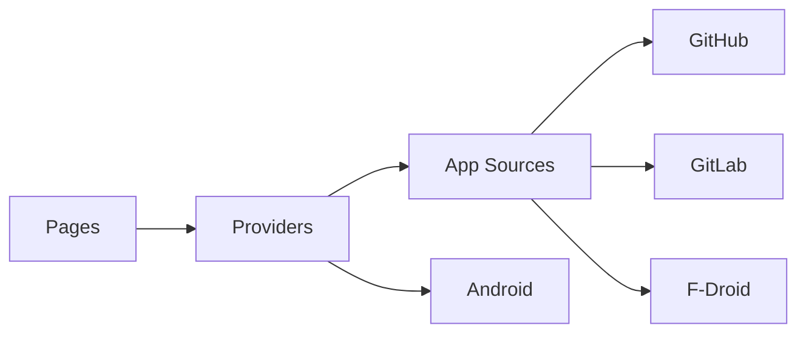

# ImranR98/Obtainium

> Android application that installs and updates apps from their release pages.

## The problem
App stores delay or filter updates; tracking versions by hand is tedious.

## What it actually does
Queries releases on GitHub, GitLab, F-Droid, IzzyOnDroid, APKPure, SourceHut and others, notifies of new versions and installs the APK. Collaborative configurations exist on a dedicated site. Flutter app; each source is a Dart module.

## How it is wired

## Trying it
No command: install from GitHub Releases, IzzyOnDroid or F-Droid. The README provides the package name `dev.imranr.obtainium` and the SHA-256 fingerprint of the certificate.

## Cost and gotchas
Free. Some sources rely on web scraping and may break.

## What it is not
Not an app store: it does not verify the content of APKs.

## Alternatives
F-Droid (cited as a source and a point of comparison).

## For you
Ignore: personal Android utility, unrelated to data / AI / MLOps.
