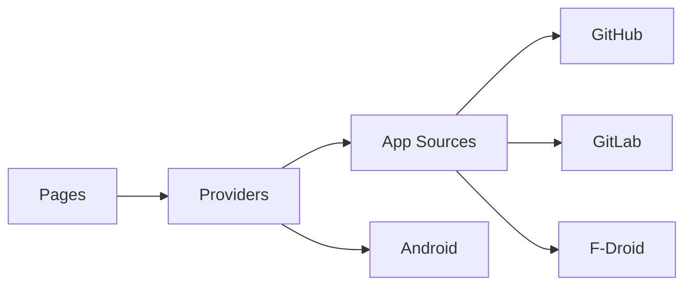

# ImranR98/Obtainium

> Application Android qui installe et met à jour des apps depuis leurs pages de publication.

## Le problème
Les boutiques d'applications retardent ou filtrent les mises à jour ; suivre les versions à la main est pénible.

## Ce que ça fait vraiment
Interroge les releases de GitHub, GitLab, F-Droid, IzzyOnDroid, APKPure, SourceHut et d'autres, notifie les nouvelles versions et installe l'APK. Des configurations collaboratives existent sur un site dédié. Application Flutter ; chaque source est un module Dart.

## Comment c'est branché

## Essayer
Aucune commande : installer depuis GitHub Releases, IzzyOnDroid ou F-Droid. Le README fournit le nom de paquet `dev.imranr.obtainium` et l'empreinte SHA-256 du certificat.

## Coût et pièges
Gratuit. Certaines sources reposent sur du scraping web et peuvent casser.

## Ce que ce n'est pas
Pas un magasin d'applications : il ne vérifie pas le contenu des APK.

## Alternatives
F-Droid (cité comme source et point de comparaison).

## Pour toi
Ignorer : utilitaire Android personnel, sans lien avec data / IA / MLOps.

