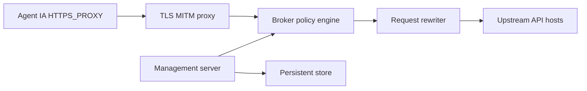

# Infisical/agent-vault

> Infisical credential broker: AI agents call APIs without ever holding the real keys.

## The problem
An agent manipulated by prompt injection can leak the secrets it holds.

## What it actually does
Single Go binary (server and CLI): an HTTPS MITM proxy on port 14322 intercepts the agent's requests, replaces placeholder values (`__anthropic_api_key__`) with the real keys, filters the output and logs. An API and a web interface on 14321 manage vaults, agents, rules and proposals. Storage is SQLite, or PostgreSQL in production; encryption with a master password. A TypeScript SDK issues short-lived tokens.

## How it is wired


## Trying it
```bash
curl --proto '=https' --proto-redir '=https' --tlsv1.2 -fsSL https://get.agent-vault.dev | sh
export AGENT_VAULT_MASTER_PASSWORD=your-password
agent-vault server -d
agent-vault run -- claude
```

## Cost and gotchas
Deploy it on a machine separate from the agents; keep the proxy port private. The README announces a preview, with an API that may change. The `ee` folder requires an Infisical license.

## What it is not
Not the recommended production solution: Infisical advises Agent Proxy (commercial). License not identified by GitHub (MIT announced, except `ee`). The telemetry module appears in the architecture.

## Alternatives
- Infisical Agent Proxy: the commercial option recommended in production.
- mitmproxy, squid: generic proxies, to be modified for this use case.

## For you
Keep an eye on it: a good idea for autonomous agents holding real keys, but still a preview.
