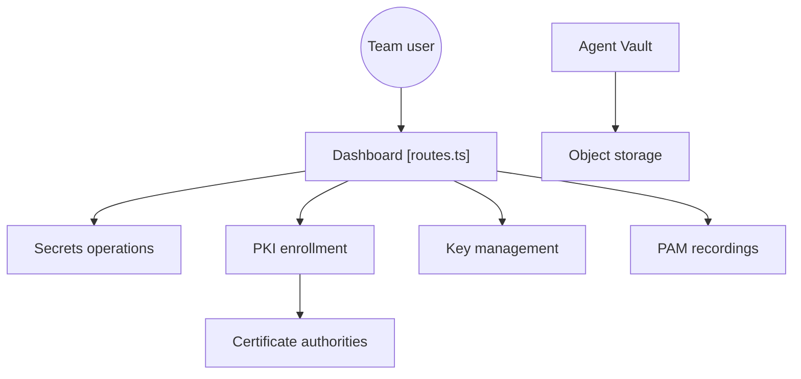

# Infisical/infisical

> Open-source security platform for secrets, certificates, keys, privileged access and AI agent access.

## The problem
Secrets, certificates and infrastructure credentials are scattered, hard to renew and hard to audit.

## What it actually does
Secrets management (versioning, rotation, dynamic secrets, sync to GitHub, AWS, Vercel), CLI leak scanning, PKI with internal or external CAs, KMS, PAM with session recording, and Agent Vault: a proxy that injects the real credentials so the agent holds none. SDKs in nine languages.

## How it is wired


## Trying it
```bash
git clone https://github.com/Infisical/infisical && cd "$(basename $_ .git)" && cp .env.example .env && docker compose -f docker-compose.prod.yml up
infisical scan --verbose
infisical scan install --pre-commit-hook
```

## Cost and gotchas
Self-hosted: Docker and a local account on localhost:80. The `ee/` folder requires a paid license.

## What it is not
Not entirely MIT: the README states MIT except for the `ee` directories, while GitHub did not identify the license. The provided graph covers the documented capabilities, not every code path.

## Alternatives
None named in the README.

## For you
Worth watching: Agent Vault and secret scanning serve an MLOps setup that hands API keys to agents; check the license and the `ee` boundary first.
