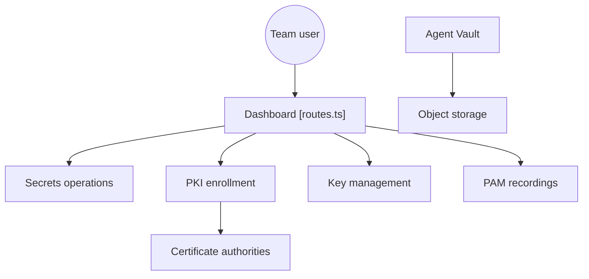

# Infisical/infisical

> Plateforme de sécurité open source pour secrets, certificats, clés, accès privilégiés et accès d'agents IA.

## Le problème
Les secrets, certificats et identifiants d'infrastructure sont dispersés, difficiles à renouveler et à auditer.

## Ce que ça fait vraiment
Gestion de secrets (versionnage, rotation, secrets dynamiques, sync vers GitHub, AWS, Vercel), scan de fuites en CLI, PKI avec CA internes ou externes, KMS, PAM avec enregistrement de sessions et Agent Vault : un proxy qui injecte les identifiants réels pour que l'agent n'en détienne aucun. SDK dans neuf langages.

## Comment c'est branché


## Essayer
```bash
git clone https://github.com/Infisical/infisical && cd "$(basename $_ .git)" && cp .env.example .env && docker compose -f docker-compose.prod.yml up
infisical scan --verbose
infisical scan install --pre-commit-hook
```

## Coût et pièges
Auto-hébergé : Docker et compte local sur localhost:80. Le dossier `ee/` exige une licence payante.

## Ce que ce n'est pas
Pas entièrement MIT : le README annonce MIT sauf les répertoires `ee`, alors que GitHub n'a pas identifié la licence. Le graphe fourni couvre les capacités documentées, pas tous les chemins du code.

## Alternatives
Aucune nommée dans le README.

## Pour toi
À surveiller : l'Agent Vault et le scan de secrets servent un MLOps qui donne des clés d'API à des agents ; vérifier d'abord la licence et la frontière `ee`.

