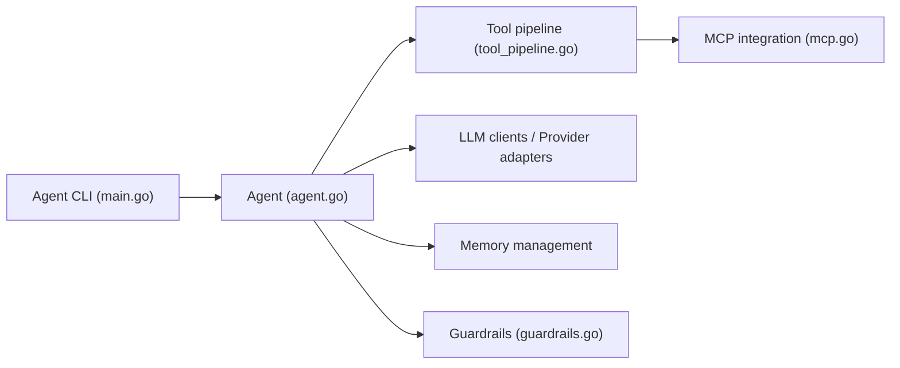

# Ingenimax/agent-sdk-go

> Go framework to build AI agents with memory, tools, MCP and several LLM providers.

## The problem
Assembling an LLM, memory, tools, guardrails and tracing in a Go service takes a lot of glue code.

## What it actually does
An agent combines an LLM client (OpenAI, Anthropic, Vertex AI, Azure, Ollama, vLLM), a memory (buffer, Redis, vector), tools and MCP servers. On top come persistent sessions (memory, Postgres, SQLite), agents declared in YAML, execution plans, multi-agent patterns, evaluation and an `agent-cli` CLI. Built-in token counting.

## How it is wired


## Trying it
```bash
go get github.com/Ingenimax/agent-sdk-go
go install github.com/Ingenimax/agent-sdk-go/cmd/agent-cli@latest
agent-cli init
export OPENAI_API_KEY=your_api_key_here
agent-cli run "What's the weather in San Francisco?"
```

## Cost and gotchas
Go 1.26+; key of the chosen provider at your expense; Redis optional. The README notes that a fix removed remote configuration loading (it could run local binaries) and repaired input guardrails, which had no effect when memory was configured: read `docs/upgrading.md` before migrating.

## What it is not
Not a ready-to-use service: it is a library. The FAQ says to "check the license" while the catalog indicates MIT. The CLI's `--dangerously-skip-permissions` flag must be handled with care.

## Alternatives
No alternative cited in the README.

## For you
Worth watching if your team writes its agents in Go: broad coverage and recent activity, but the security bugs that were fixed are a reminder to read the upgrade guide.
