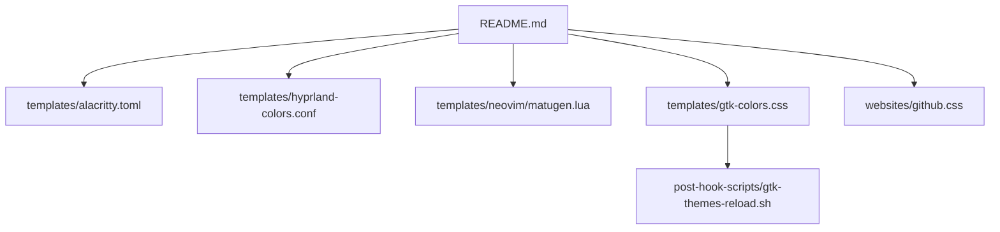

# InioX/matugen-themes

> Collection of color templates for matugen, one per application or website.

## The problem
Aligning the colors of dozens of programs with the wallpaper is done by hand, file by file.

## What it actually does
Provides templates for about sixty programs (terminals, Hyprland, GTK, Neovim, Waybar, VS Code...) and for websites (YouTube, GitHub, Bitwarden). Each section of the README gives the block to add to the matugen configuration. A script reloads the GTK themes.

## How it is wired


## Trying it
```bash
# Aucune commande : copier un modèle puis déclarer dans le config.toml de matugen :
# [templates.alacritty]
# input_path = 'path/to/template'
# output_path = '~/.config/alacritty/colors.toml'
```

## Cost and gotchas
Requires matugen. Papirus Folders needs a passwordless sudoers rule: review it before applying. README truncated in the list.

## What it is not
Not a standalone tool: without matugen, these are just files.

## Alternatives
None named in the README.

## For you
Ignore: Linux desktop customization, unrelated to your work.
