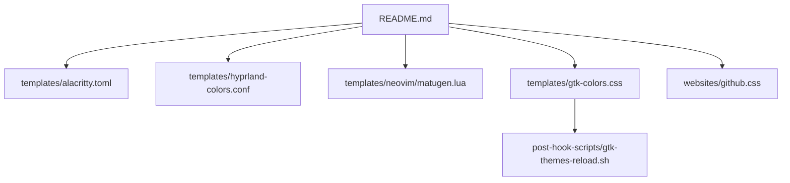

# InioX/matugen-themes

> Collection de modèles de couleurs pour matugen, un par application ou site.

## Le problème
Aligner les couleurs de dizaines de programmes sur le fond d'écran se fait à la main, fichier par fichier.

## Ce que ça fait vraiment
Fournit des modèles pour une soixantaine de programmes (terminaux, Hyprland, GTK, Neovim, Waybar, VS Code...) et pour des sites (YouTube, GitHub, Bitwarden). Chaque section du README donne le bloc à ajouter à la configuration de matugen. Un script recharge les thèmes GTK.

## Comment c'est branché


## Essayer
```bash
# Aucune commande : copier un modèle puis déclarer dans le config.toml de matugen :
# [templates.alacritty]
# input_path = 'path/to/template'
# output_path = '~/.config/alacritty/colors.toml'
```

## Coût et pièges
Il faut matugen. Papirus Folders demande une règle sudoers sans mot de passe : à examiner avant de l'appliquer. README tronqué dans la liste.

## Ce que ce n'est pas
Pas un outil autonome : sans matugen, ce ne sont que des fichiers.

## Alternatives
Aucune nommée dans le README.

## Pour toi
À ignorer : personnalisation de bureau Linux, sans lien avec ton métier.

