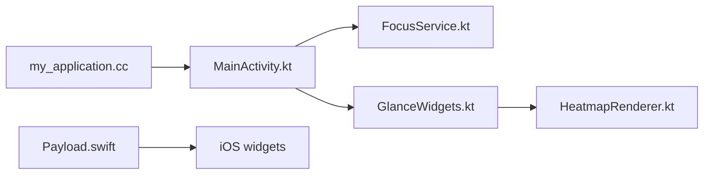

# InlitX/streak

> Minimalist, private, ad-free habit tracker for Android, Windows and Linux.

## The problem
Habit apps force an account, ads or cloud sync.

## What it actually does
Logs habits in one tap (regular, to avoid, quantitative), flexible schedule, activity grid, statistics, Pomodoro focus sessions, widgets, reminders, import from Loop, HabitKit, Habitica and HabitBull. Everything stays offline: no Internet permission on Android.

## How it is wired


## Trying it
```text
Android : F-Droid, IzzyOnDroid ou APK (Streak-arm64-v8a.apk)
Linux : Streak-x86_64.AppImage, rendre exécutable puis lancer
```

## Cost and gotchas
Free. Recent Linux build: the README warns of rough edges. iOS in progress, macOS planned.

## What it is not
Not synced across devices: manual backup by file or folder. The main Flutter code is not detailed in the architecture provided.

## Alternatives
- Loop Habit Tracker, cited as an inspiration.

## For you
Ignore: a personal app unrelated to data/AI/MLOps; GPL-3.0.
