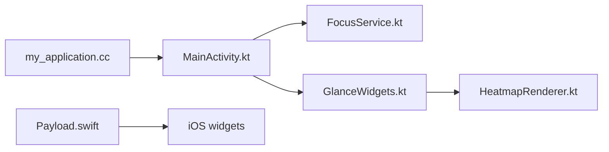

# InlitX/streak

> Suivi d'habitudes minimaliste, privé et sans publicité pour Android, Windows et Linux.

## Le problème
Les applis d'habitudes imposent compte, publicité ou synchronisation cloud.

## Ce que ça fait vraiment
Journalise des habitudes d'un geste (normales, à éviter, quantitatives), planning flexible, grille d'activité, statistiques, séances de focus Pomodoro, widgets, rappels, import depuis Loop, HabitKit, Habitica et HabitBull. Tout reste hors ligne : aucune permission Internet sur Android.

## Comment c'est branché


## Essayer
```text
Android : F-Droid, IzzyOnDroid ou APK (Streak-arm64-v8a.apk)
Linux : Streak-x86_64.AppImage, rendre exécutable puis lancer
```

## Coût et pièges
Gratuit. Build Linux récent : le README annonce des aspérités. iOS en cours, macOS prévu.

## Ce que ce n'est pas
Pas synchronisé entre appareils : sauvegarde manuelle par fichier ou dossier. Le code Flutter principal n'est pas détaillé dans l'architecture fournie.

## Alternatives
- Loop Habit Tracker, cité comme inspiration.

## Pour toi
Ignorer : application personnelle sans lien avec data/IA/MLOps ; GPL-3.0.

