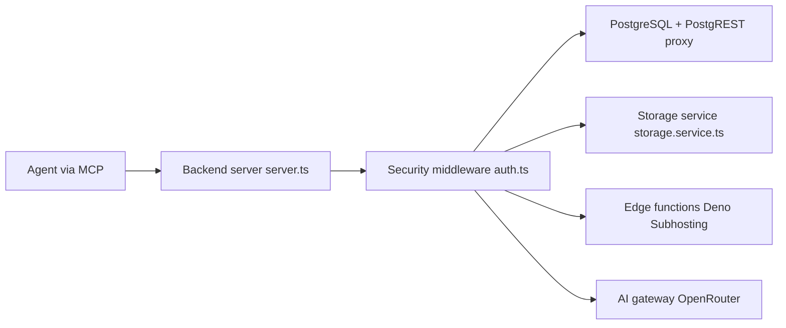

# InsForge/InsForge

> Open source backend platform (database, auth, storage, functions) driven by coding agents.

## The problem
An agent that writes a complete application must also set up the database, authentication and storage, without the tools of a backend engineer.

## What it actually does
An MCP server (self-hosted or cloud) and a CLI with skills (cloud only) expose the operations: reading the schema, functions and logs, migrations, buckets, auth providers. Services: Postgres via PostgREST, S3-compatible storage (local, MinIO, RustFS), a model gateway via OpenRouter, edge functions on Deno Subhosting, compute (private preview), deployment via Vercel, realtime, Stripe/Razorpay payments.

## How it is wired


## Trying it
```bash
curl -fsSL https://raw.githubusercontent.com/InsForge/InsForge/main/deploy/setup.sh | sh -s ~/insforge
cd ~/insforge
docker compose up -d
```

## Cost and gotchas
Docker with Compose v2. Several projects on one machine need distinct names and ports. The MinIO/RustFS overlays ship default credentials that must be changed. Edge functions, deployment and the AI gateway rely on external providers.

## What it is not
The CLI and skills are only available on the cloud. Container compute is in private preview.

## Alternatives
No alternative named in the README.

## For you
Worth watching: handy for prototyping a demo backend with an agent; check the cloud part before using it with real data.
