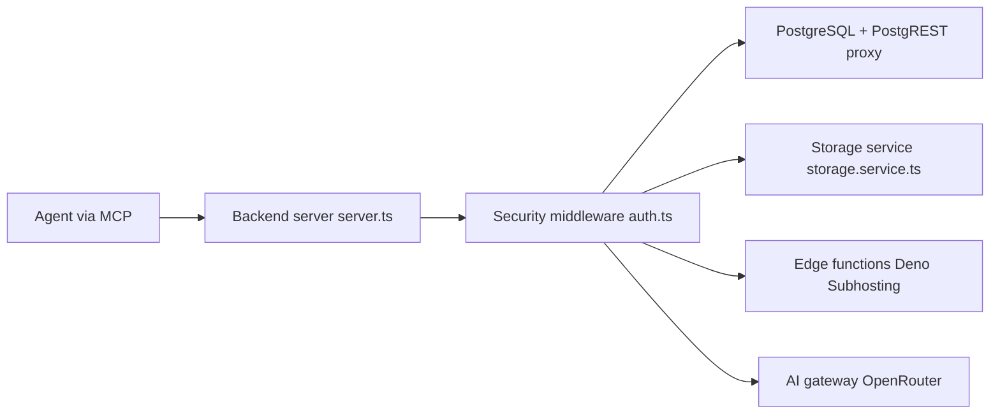

# InsForge/InsForge

> Plateforme backend open source (base, auth, stockage, fonctions) pilotée par des agents de code.

## Le problème
Un agent qui écrit une application complète doit aussi configurer base de données, authentification et stockage, sans les outils d'un ingénieur backend.

## Ce que ça fait vraiment
Un serveur MCP (auto-hébergé ou cloud) et un CLI avec skills (cloud seulement) exposent les opérations : lecture du schéma, des fonctions et des journaux, migrations, buckets, fournisseurs d'auth. Services : Postgres via PostgREST, stockage compatible S3 (local, MinIO, RustFS), passerelle de modèles via OpenRouter, fonctions edge sur Deno Subhosting, compute (aperçu privé), déploiement via Vercel, temps réel, paiements Stripe/Razorpay.

## Comment c'est branché


## Essayer
```bash
curl -fsSL https://raw.githubusercontent.com/InsForge/InsForge/main/deploy/setup.sh | sh -s ~/insforge
cd ~/insforge
docker compose up -d
```

## Coût et pièges
Docker avec Compose v2. Plusieurs projets sur une machine demandent des noms et ports distincts. Les overlays MinIO/RustFS livrent des identifiants par défaut à changer. Fonctions edge, déploiement et passerelle IA reposent sur des fournisseurs externes.

## Ce que ce n'est pas
Le CLI et les skills ne sont disponibles que sur le cloud. Le calcul de conteneurs est en aperçu privé.

## Alternatives
Aucune alternative nommée dans le README.

## Pour toi
À surveiller : pratique pour prototyper un backend de démonstration avec un agent ; vérifie la part cloud avant de l'utiliser avec des données réelles.

