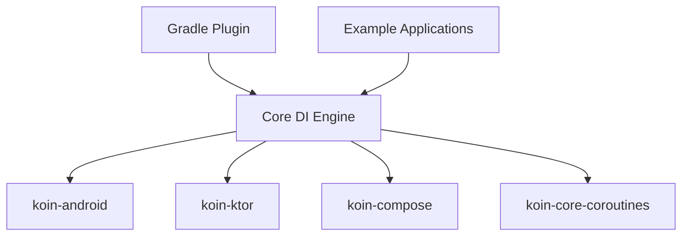

# InsertKoinIO/koin

> Kotlin dependency injection framework, with compile-time verification, for Android and multiplatform developers.

## The problem
Wiring the dependencies of a Kotlin application by hand becomes fragile, and errors only show up at runtime.

## What it actually does
Offers a DSL to declare modules and resolve dependencies. A compiler plugin checks the graph before execution. Modules cover Android, Ktor, Compose and multiplatform. "Skills" exist for coding agents (Claude Code, Cursor).

## How it is wired



## Trying it
```bash
/plugin marketplace add InsertKoinIO/koin-skills
/plugin install koin@koin-skills
npx skills add InsertKoinIO/koin-skills
```
Adding the dependency is done through Gradle, as described in the installation page of the documentation.

## Cost and gotchas
Free; the Kotzilla platform (crash reporting, observability) is a separate service requiring sign-up. `npx skills` requires Node.js 22 or later.

## What it is not
Not a testing or monitoring tool: the Kotzilla platform and the IDE plugin are separate add-ons.

## Alternatives
- Hilt, Dagger, Toothpick, Kodein, Metro: cited as migration sources to Koin.

## For you
Ignore: Kotlin and Android development tool, outside the data, AI or MLOps scope.
