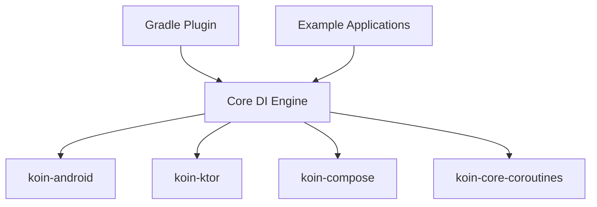

# InsertKoinIO/koin

> Framework Kotlin d'injection de dépendances, avec vérification à la compilation, pour développeurs Android et multiplateforme.

## Le problème
Câbler à la main les dépendances d'une application Kotlin devient fragile, et les erreurs ne se voient qu'à l'exécution.

## Ce que ça fait vraiment
Offre un DSL pour déclarer des modules et résoudre les dépendances. Un plugin de compilateur vérifie le graphe avant l'exécution. Des modules couvrent Android, Ktor, Compose et le multiplateforme. Des « skills » existent pour agents de code (Claude Code, Cursor).

## Comment c'est branché



## Essayer
```bash
/plugin marketplace add InsertKoinIO/koin-skills
/plugin install koin@koin-skills
npx skills add InsertKoinIO/koin-skills
```
L'ajout de la dépendance se fait par Gradle, comme décrit dans la page d'installation de la documentation.

## Coût et pièges
Gratuit ; la plateforme Kotzilla (rapport de plantages, observabilité) est un service distinct avec inscription. `npx skills` demande Node.js 22 ou plus.

## Ce que ce n'est pas
Pas un outil de test ni de supervision : la plateforme Kotzilla et le plugin IDE sont des compléments à part.

## Alternatives
- Hilt, Dagger, Toothpick, Kodein, Metro : cités comme sources de migration vers Koin.

## Pour toi
À ignorer : outil de développement Kotlin et Android, hors du périmètre data, IA ou MLOps.

