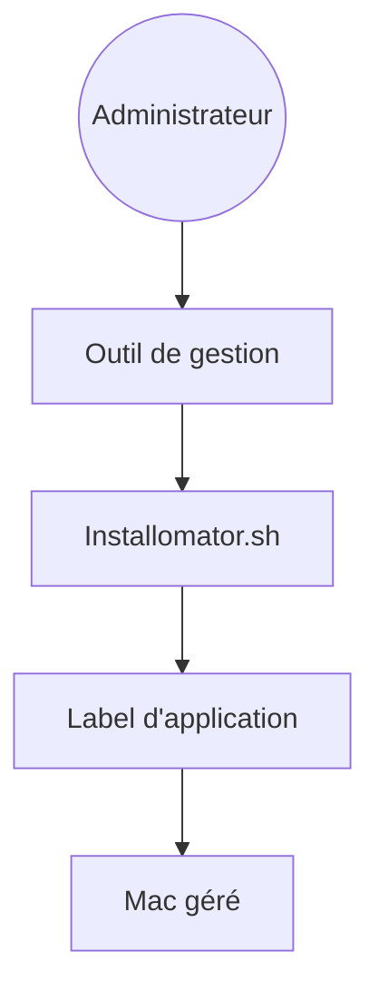

# Installomator/Installomator

> Single shell script that installs and updates macOS applications, for fleet administrators.

## The problem
Deploying and updating dozens of applications on managed Macs requires one script per piece of software.

## What it actually does
The README only details the context: a single `Installomator.sh` script with per-application "labels", whose changes must not affect the rest of the script. The full operation is deferred to the wiki (variables, labels, execution methods).

## How it is wired
Simplified diagram based on the sheet, no diagram provided.

## Trying it
No command documented in the README: download `Installomator.sh` from the Releases or the `release` branch, then follow the wiki.

## Cost and gotchas
Free. The `main` branch is a beta: the README asks to test thoroughly before production and refuses any promise of no regression. More than 160 open issues.

## What it is not
Not a Windows or Linux tool. Not a stable version on `main`.

## Alternatives
No alternative named in the README.

## For you
Ignore: macOS fleet management unrelated to data, AI or MLOps.
