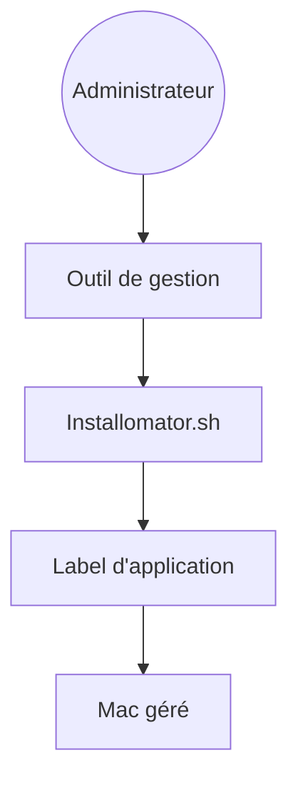

# Installomator/Installomator

> Script shell unique qui installe et met à jour des applications macOS, pour les administrateurs de parc.

## Le problème
Déployer et mettre à jour des dizaines d'applications sur des Mac gérés demande un script par logiciel.

## Ce que ça fait vraiment
Le README ne détaille que le contexte : un script `Installomator.sh` avec des « labels » par application, dont les changements ne doivent pas affecter le reste du script. Le fonctionnement complet est renvoyé au wiki (variables, labels, méthodes d'exécution).

## Comment c'est branché
Schéma simplifié d'après la fiche, sans diagramme fourni.

## Essayer
Aucune commande documentée dans le README : télécharger `Installomator.sh` depuis les Releases ou la branche `release`, puis suivre le wiki.

## Coût et pièges
Gratuit. La branche `main` est une bêta : le README demande de tester à fond avant la production et refuse toute promesse de non-régression. Plus de 160 issues ouvertes.

## Ce que ce n'est pas
Ce n'est pas un outil Windows ou Linux. Ce n'est pas une version stable sur `main`.

## Alternatives
Aucune alternative nommée dans le README.

## Pour toi
À ignorer : gestion de parc macOS sans lien avec la data, l'IA ou le MLOps.

