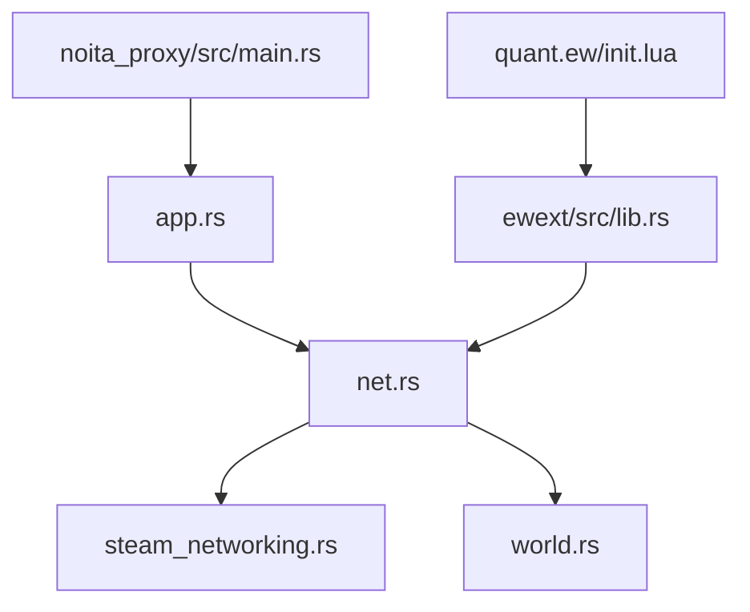

# IntQuant/noita_entangled_worlds

> Online cooperative multiplayer mod for the game Noita, with a network proxy.

## The problem
Noita is a single-player game; playing with others requires synchronizing a world in which every pixel is simulated.

## What it actually does
Synchronizes players, wands, items, enemies, world pixels, fungal shifts and polymorphs. A proxy handles the lobby and the network (Steam or IP) and installs the mod; a native extension and a Lua mod exchange messages with it. Connecting from the command line is possible.

## How it is wired


## Trying it
```bash
noita_proxy --lobby [steam_code/ip et port]
noita_proxy --host steam
noita_proxy --host 5123
```

## Cost and gotchas
Free, but Noita must be owned (Steam or GOG). Unsafe mods must be enabled in the game. macOS goes through Wine and a terminal launch.

## What it is not
Not a mod for a save shared with single-player: do not mix the two.

## Alternatives
No alternative named in the README.

## For you
Ignore: a video game mod, outside the data, AI or MLOps scope.
