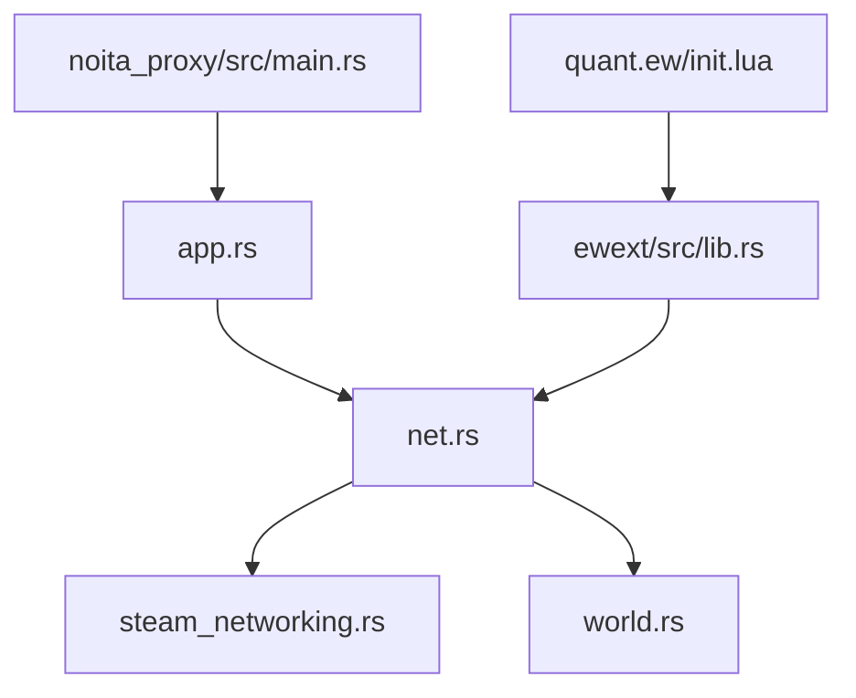

# IntQuant/noita_entangled_worlds

> Mod multijoueur coopératif en ligne pour le jeu Noita, avec proxy réseau.

## Le problème
Noita est un jeu solo ; jouer à plusieurs exige de synchroniser un monde dont chaque pixel est simulé.

## Ce que ça fait vraiment
Synchronise joueurs, baguettes, objets, ennemis, pixels du monde, fungal shifts et polymorphes. Un proxy gère le lobby et le réseau (Steam ou IP) et installe le mod ; une extension native et un mod Lua échangent des messages avec lui. Connexion possible en ligne de commande.

## Comment c'est branché


## Essayer
```bash
noita_proxy --lobby [steam_code/ip et port]
noita_proxy --host steam
noita_proxy --host 5123
```

## Coût et pièges
Gratuit, mais Noita doit être possédé (Steam ou GOG). Mods non sûrs à activer dans le jeu. macOS passe par Wine et un lancement par terminal.

## Ce que ce n'est pas
Pas un mod pour sauvegarde partagée avec le solo : ne mélange pas les deux parties.

## Alternatives
Aucune alternative nommée dans le README.

## Pour toi
Ignorer : un mod de jeu vidéo, hors périmètre data, IA ou MLOps.

