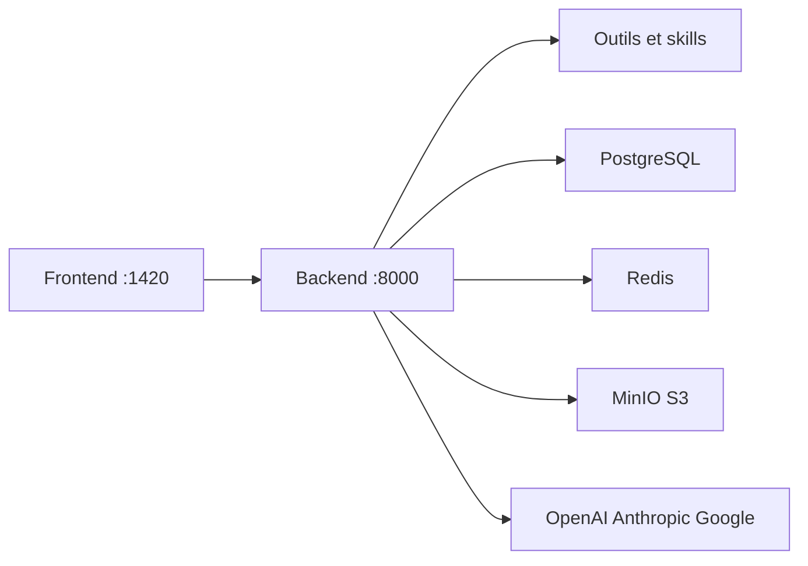

# Intelligent-Internet/ii-agent

> Open general-purpose agent (research, websites, slides, documents) that you host with your own LLM keys.

## The problem
"All-in-one" agents are often closed; you want to keep control of them and choose your own model provider.

## What it actually does
Interface and backend (port 8000, frontend 1420) with PostgreSQL, Redis and MinIO. The agent plans in several steps, runs quick or in-depth research, generates websites, mobile apps, slide decks, illustrated books, images and videos, and handles PDF, Excel, Word and PowerPoint. Skills, integrations (Gmail, Slack, GitHub, Notion...) and multi-model chat are offered. Models are declared in `model_configs.yaml` or `MODEL_CONFIGS`.

## How it is wired


## Trying it
```bash
git clone https://github.com/Intelligent-Internet/ii-agent.git
cd ii-agent
make setup
make dev-all
make stack
```

## Cost and gotchas
Docker, `uv` and Node required; at least one LLM provider key at your expense. Default MinIO credentials (`minioadmin`) must be changed. The generated architecture describes an earlier version (`cli.py`, `ws_server.py`) that does not match the README's `make`-based startup.

## What it is not
Not a simple chat assistant: the stack is heavy. The listed capabilities are those of the README, with no independent evaluation.

## Alternatives
No alternative is cited in the README.

## For you
Worth watching: open and BYOK, but a heavy and very broad stack; try it on a specific case before committing to it.
