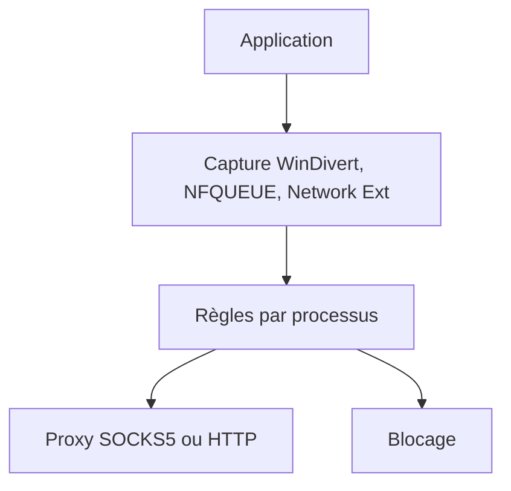

# InterceptSuite/ProxyBridge

> Transparent proxy client for Windows, macOS and Linux that redirects the traffic of specific applications through SOCKS5 or HTTP.

## The problem
Many applications do not support a proxy; their traffic has to be forced through one, as with Proxifier.

## What it actually does
Intercepts TCP and UDP packets at system level (WinDivert on Windows, Network Extension on macOS, NFQUEUE on Linux) and routes, blocks or lets them through per process. Rules by process, IP, port, protocol and hostname, JSON import/export, graphical interface and CLI. It carries traffic but does not inspect it: TLS inspection belongs to InterceptSuite, a separate product.

## How it is wired
Simplified diagram based on the sheet, no diagram provided.



## Trying it
```bash
curl -Lo deploy.sh https://raw.githubusercontent.com/InterceptSuite/ProxyBridge/refs/heads/master/Linux/deploy.sh && sudo bash deploy.sh
brew install --cask proxybridge
winget install InterceptSuite.ProxyBridge
```

## Cost and gotchas
Free. Administrator rights required; Linux needs a kernel with NFQUEUE. The README warns about fake malicious downloads: use official sources only. The only announced external call is an update check at launch; the winget package is community-maintained.

## What it is not
Not a traffic inspection tool nor a VPN. It redirects; it neither encrypts nor decrypts.

## Alternatives
- Proxifier: named as the product ProxyBridge is an alternative to.
- InterceptSuite: MITM proxy from the same publisher, for inspecting traffic.

## For you
Ignore: useful for testing applications behind a proxy, but of little relevance to your day-to-day data / AI / MLOps work.
