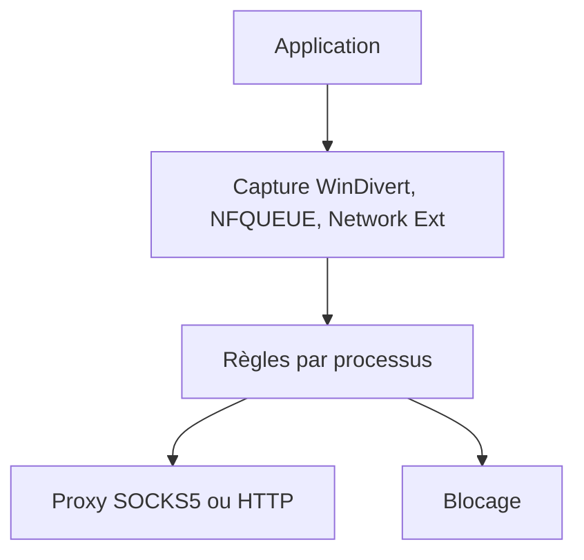

# InterceptSuite/ProxyBridge

> Client proxy transparent pour Windows, macOS et Linux qui redirige le trafic d'applications précises via SOCKS5 ou HTTP.

## Le problème
Beaucoup d'applications ne gèrent pas de proxy ; il faut forcer leur trafic à passer par un proxy, comme avec Proxifier.

## Ce que ça fait vraiment
Intercepte les paquets TCP et UDP au niveau système (WinDivert sous Windows, Network Extension sous macOS, NFQUEUE sous Linux) et les route, bloque ou laisse passer par processus. Règles par processus, IP, port, protocole et nom d'hôte, import/export JSON, interface graphique et CLI. Il achemine le trafic mais ne l'inspecte pas : l'inspection TLS relève d'InterceptSuite, produit distinct.

## Comment c'est branché
Schéma simplifié d'après la fiche, sans diagramme fourni.



## Essayer
```bash
curl -Lo deploy.sh https://raw.githubusercontent.com/InterceptSuite/ProxyBridge/refs/heads/master/Linux/deploy.sh && sudo bash deploy.sh
brew install --cask proxybridge
winget install InterceptSuite.ProxyBridge
```

## Coût et pièges
Gratuit. Droits administrateur requis ; Linux demande un noyau avec NFQUEUE. Le README signale de faux téléchargements malveillants : n'utiliser que les sources officielles. Seul appel externe annoncé : un flux de mise à jour au lancement ; le paquet winget est communautaire.

## Ce que ce n'est pas
Pas un outil d'inspection de trafic ni un VPN. Il redirige, il ne chiffre ni ne déchiffre.

## Alternatives
- Proxifier : cité comme produit dont ProxyBridge est l'alternative.
- InterceptSuite : proxy MITM du même éditeur, pour inspecter le trafic.

## Pour toi
À ignorer : utile pour tester des applications derrière un proxy, mais peu pertinent pour ton travail data / IA / MLOps courant.

