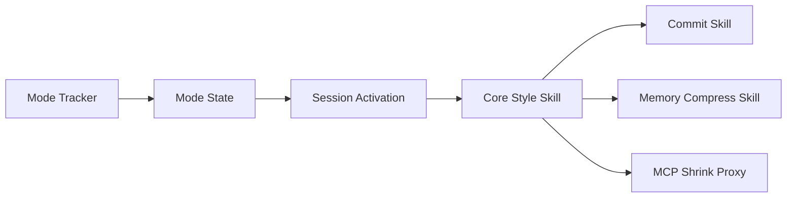

# InterfaceX-co-jp/genshijin

> Claude Code and Codex plugin that compresses Japanese responses to reduce token consumption.

## The problem
Japanese responses are full of politeness formulas, which consume output tokens with no technical value.

## What it actually does
A skill enforces three levels of telegraphic style (polite, normal, extreme) through startup and input hooks that re-inject the rules on every turn. Sub-skills produce commits and PR reviews, compress memory files (`CLAUDE.md`) with a backup, display token statistics and provide three sub-agents. An MCP proxy shortens tool descriptions, and rules exist for Cursor, Windsurf, Cline and Copilot.

## How it is wired


## Trying it
```bash
/plugin install genshijin
npx skills add InterfaceX-co-jp/genshijin
/genshijin-compress ~/.claude/CLAUDE.md
```

## Cost and gotchas
Free; memory compression requires Python 3.10+ and either `ANTHROPIC_API_KEY` or a logged-in claude CLI. It overwrites the target file (backup in `CLAUDE.original.md`). The hook writes a state file in `~/.claude`.

## What it is not
The quoted gains (83% on average) come from in-house, non-independent benchmarks; in English the advantage over caveman is small (7%). Not designed for detailed human reading.

## Alternatives
The README mentions caveman (JuliusBrussee/caveman), the original English version.

## For you
Keep an eye on it: cheap to test if you talk to an agent in Japanese; the benefit is nil in French, and the figures remain self-reported.
