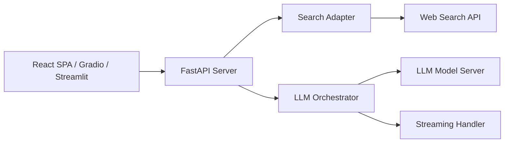

# InternLM/MindSearch

> Web search engine built on LLM agents, with a FastAPI backend and several frontends.

## The problem
A single web query plus an LLM misses complex questions that require breaking them down and cross-checking several searches.

## What it actually does
An agent (Lagent framework) breaks the question down into sub-queries run in parallel on a web search engine (DuckDuckGo, Bing, Brave, Google Serper, Tencent).
The results are aggregated by an LLM (local InternLM2.5-7b or GPT-4) and streamed back.
React, Gradio or Streamlit frontends; a `backend_example.py` script for direct use.
Last push in July 2025.

## How it is wired


## Trying it
```bash
git clone https://github.com/InternLM/MindSearch
cd MindSearch
pip install -r requirements.txt
mv .env.example .env
python -m mindsearch.app --lang en --model_format internlm_server --search_engine DuckDuckGoSearch --asy
python -m mindsearch.terminal
```

## Cost and gotchas
Search engine API key (except DuckDuckGo); GPU for local InternLM or an OpenAI key.
Project not updated for more than a year.

## What it is not
Not a maintained product: a search demonstrator tied to a paper.
Not optimized for other models without modifying the code.

## Alternatives
- Lagent: the underlying agent framework, if you want to build your own.

## For you
Ignore: interesting parallel-search idea but the project is frozen; current deep research solutions go further.
