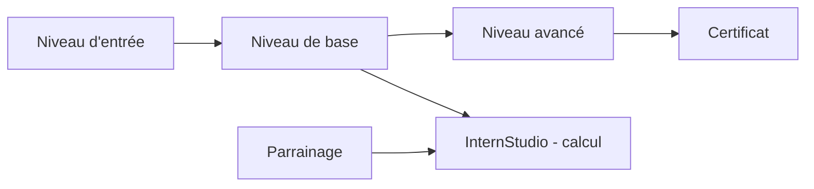

# InternLM/Tutorial

> Chinese-language training path (3rd session) for learning to use, fine-tune and deploy InternLM.

## The problem
Learning the full chain of an open large model (prompt, RAG, fine-tuning, evaluation, deployment) without a guided path takes a long time.

## What it actually does
The README is a table of contents of "levels": prerequisites (Linux, Python, Git), basics (InternLM ecosystem, 8 GB VRAM demo, prompts, RAG with LlamaIndex, XTuner fine-tuning, OpenCompass evaluation), advanced (Lagent, LMDeploy, InternVL, Huixiangdou, MindSearch CPU) and bonus (Android deployment, the "Undercover" game). Each level links to tasks, docs and videos hosted elsewhere. InternStudio compute-point rewards are attached to the levels and to referrals.

## How it is wired

(Diagram based on the README; no code graph.)

## Trying it
No command in the README: everything goes through the path manual (Feishu link) and the InternStudio platform.

## Cost and gotchas
The content is free; compute points are given but limited, and GPU access goes through an InternStudio account. Documentation is in Chinese. 813 open issues. No license.

## What it is not
Not a library or executable code: a course outline. Part of the README is the referral program.

## Alternatives
None named in the README.

## For you
Watch: a complete program on open LLMs, useful if you read Chinese; otherwise the content remains hard to access.
