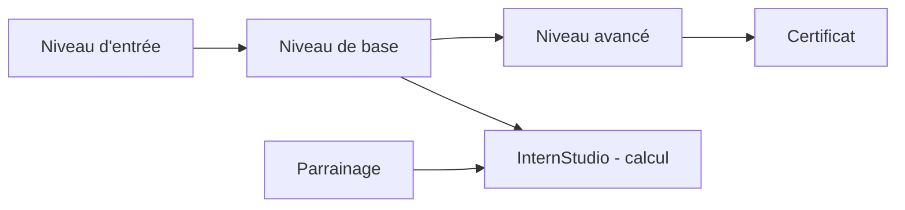

# InternLM/Tutorial

> Parcours de formation en chinois (3e session) pour apprendre à utiliser, ajuster et déployer InternLM.

## Le problème
Se former à la chaîne complète d'un grand modèle ouvert (prompt, RAG, fine-tuning, évaluation, déploiement) sans parcours guidé est long.

## Ce que ça fait vraiment
Le README est un sommaire de « niveaux » : prérequis (Linux, Python, Git), bases (écosystème InternLM, démo à 8 Go de VRAM, prompts, RAG avec LlamaIndex, fine-tuning XTuner, évaluation OpenCompass), avancé (Lagent, LMDeploy, InternVL, Huixiangdou, MindSearch CPU) et bonus (déploiement Android, jeu « Undercover »). Chaque niveau renvoie vers tâches, docs et vidéos hébergées ailleurs. Des récompenses en points de calcul InternStudio sont attachées aux niveaux et au parrainage.

## Comment c'est branché

(Schéma d'après le README ; pas de graphe de code.)

## Essayer
Aucune commande dans le README : tout passe par le manuel de parcours (lien Feishu) et la plateforme InternStudio.

## Coût et pièges
Contenu gratuit ; les points de calcul sont offerts mais limités, et l'accès aux GPU passe par un compte InternStudio. Documentation en chinois. 813 issues ouvertes. Licence absente.

## Ce que ce n'est pas
Pas une bibliothèque ni du code exécutable : un sommaire de cours. Une partie du README est du programme de parrainage.

## Alternatives
Aucune nommée dans le README.

## Pour toi
Surveiller : programme complet sur les LLM ouverts, utile si tu lis le chinois ; sinon les contenus restent peu accessibles.

