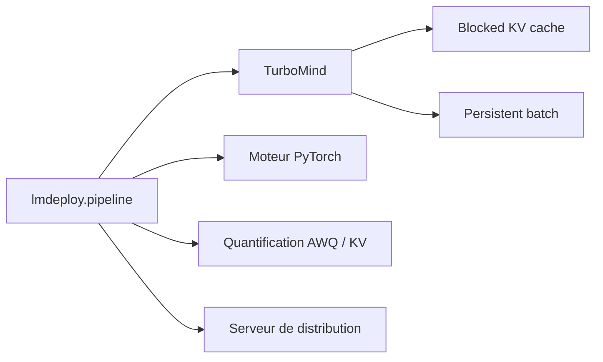

# InternLM/lmdeploy

> Toolkit to compress, quantize and serve LLMs on GPU, from the MMRazor/MMDeploy team.

## The problem
Serving an LLM at decent throughput requires continuous batching, a blocked KV cache, tensor
parallelism and quantization, each being a separate project if you recode them yourself.

## What it actually does
Two inference engines (TurboMind and PyTorch) behind the same `pipeline()` API. Persistent batch,
blocked KV cache, dynamic split&fuse, in-house CUDA kernels. Weight-only and k/v quantization,
with AWQ and automatic prefix caching usable at the same time. A request distribution service to
deploy several models across several machines and cards.

## How it is wired


## Trying it
```bash
conda create -n lmdeploy python=3.12 -y
conda activate lmdeploy
pip install lmdeploy
pip install modelscope
export LMDEPLOY_USE_MODELSCOPE=True
```

## Cost and gotchas
Free, but a GPU is mandatory. Python 3.10–3.13. Since v0.13.0 the PyPI wheels are built for CUDA
12.8: another CUDA version requires a manual installation. By default the weights are pulled from
HuggingFace, unless an environment variable points to ModelScope or openMind Hub.

## What it is not
It is not a training or fine-tuning framework. The announced gains (1.8× vLLM, 2.4× in 4-bit) come
from the README, not from an independent measurement.

## Alternatives
- **vLLM**: cited as a point of comparison; broader ecosystem, more integrations.
- **BentoLMDeploy**: cited as a third-party project, to package the service with BentoML.

## For you
The right choice if you serve InternLM/Qwen models on your own GPU and throughput matters.
