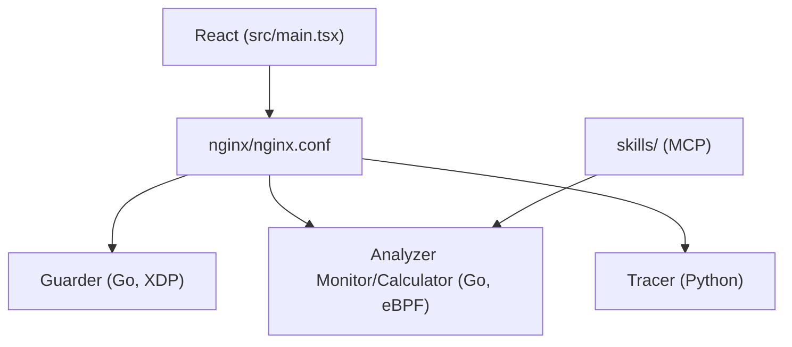

# Internet-Architecture-and-Security/PacketScope

> Server network stack analysis via eBPF: traffic, routes and filtering, with LLM assistance.

## The problem
Bottlenecks and low-level attacks slip under classic WAFs and IDSs.

## What it actually does
Four modules behind an nginx: Analyzer (Go, eBPF) captures packets and computes PPS, latency and losses; Tracer (Python) follows routes with GeoIP and Spamhaus risk; Guarder filters in XDP and generates rules via LLM; a React dashboard. Each module exposes an MCP server for agents.

## How it is wired


## Trying it
```bash
git clone https://github.com/Internet-Architecture-and-Security/PacketScope.git
cd PacketScope
sudo bash starter.sh
sudo docker compose -f docker-compose.yml ps
```

## Cost and gotchas
Docker 20.10 and Compose 2.0. AI-assisted filtering requires an OpenAI- or Anthropic-compatible API key. Privileged execution (eBPF, XDP) on the server.

## What it is not
Not a certified IDS: a young project. Only install it on a server whose kernel you control.

## Alternatives
No alternative named in the README; classic WAFs and IDSs serve as the point of comparison.

## For you
Watch: the coupling of eBPF, MCP servers and LLM is instructive for MLOps and observability, but requires root rights.
