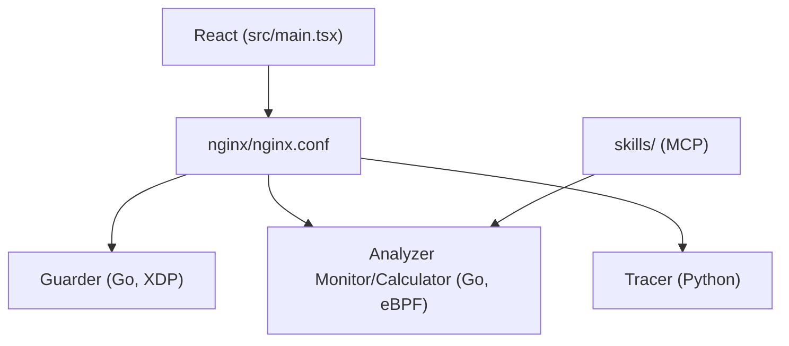

# Internet-Architecture-and-Security/PacketScope

> Analyse de la pile réseau serveur par eBPF : trafic, routes et filtrage, avec aide d'un LLM.

## Le problème
Les goulots d'étranglement et les attaques de bas niveau passent sous les WAF et IDS classiques.

## Ce que ça fait vraiment
Quatre modules derrière un nginx : Analyzer (Go, eBPF) capture les paquets et calcule PPS, latence et pertes ; Tracer (Python) suit les routes avec GeoIP et risque Spamhaus ; Guarder filtre en XDP et génère des règles par LLM ; un tableau de bord React. Chaque module expose un serveur MCP pour des agents.

## Comment c'est branché


## Essayer
```bash
git clone https://github.com/Internet-Architecture-and-Security/PacketScope.git
cd PacketScope
sudo bash starter.sh
sudo docker compose -f docker-compose.yml ps
```

## Coût et pièges
Docker 20.10 et Compose 2.0. Le filtrage assisté par IA suppose une clé d'API compatible OpenAI ou Anthropic. Exécution privilégiée (eBPF, XDP) sur le serveur.

## Ce que ce n'est pas
Pas un IDS certifié : jeune projet. Ne l'installer que sur un serveur dont tu maîtrises le noyau.

## Alternatives
Aucune alternative nommée dans le README ; WAF et IDS classiques servent de point de comparaison.

## Pour toi
Surveiller : le couplage eBPF, serveurs MCP et LLM est instructif côté MLOps et observabilité, mais exige des droits root.

