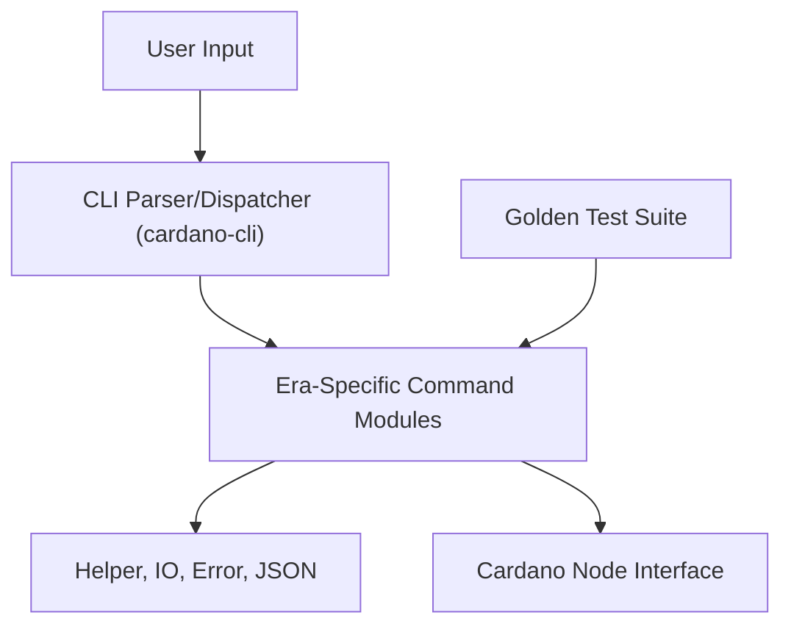

# IntersectMBO/cardano-cli

> Command-line interface for interacting with the Cardano blockchain, for operators and developers.

## The problem
Managing keys, transactions, delegation and governance on Cardano requires an official scriptable tool.

## What it actually does
The CLI manages payment and stake keys, sending ada, stake pools, DReps, delegation and on-chain queries. It also lets you interact with scripts and vote on governance actions. The code, in Haskell, separates commands by protocol era (Byron, EraBased, Compatible).

## How it is wired


## Trying it
```bash
cat certificate.json | cardano-cli debug certificate view --certificate-file -
```

## Cost and gotchas
Binaries are downloaded from the cardano-node or cardano-cli release notes, to be chosen according to the node version. Many commands assume a reachable cardano-node.

## What it is not
It is not a consumer wallet nor a node: it is a client of cardano-node. The README refers to external sites for each command's documentation.

## Alternatives
- No alternative named in the README.

## For you
Ignore: Cardano-specific tool, unrelated to a data / AI / MLOps profile.
