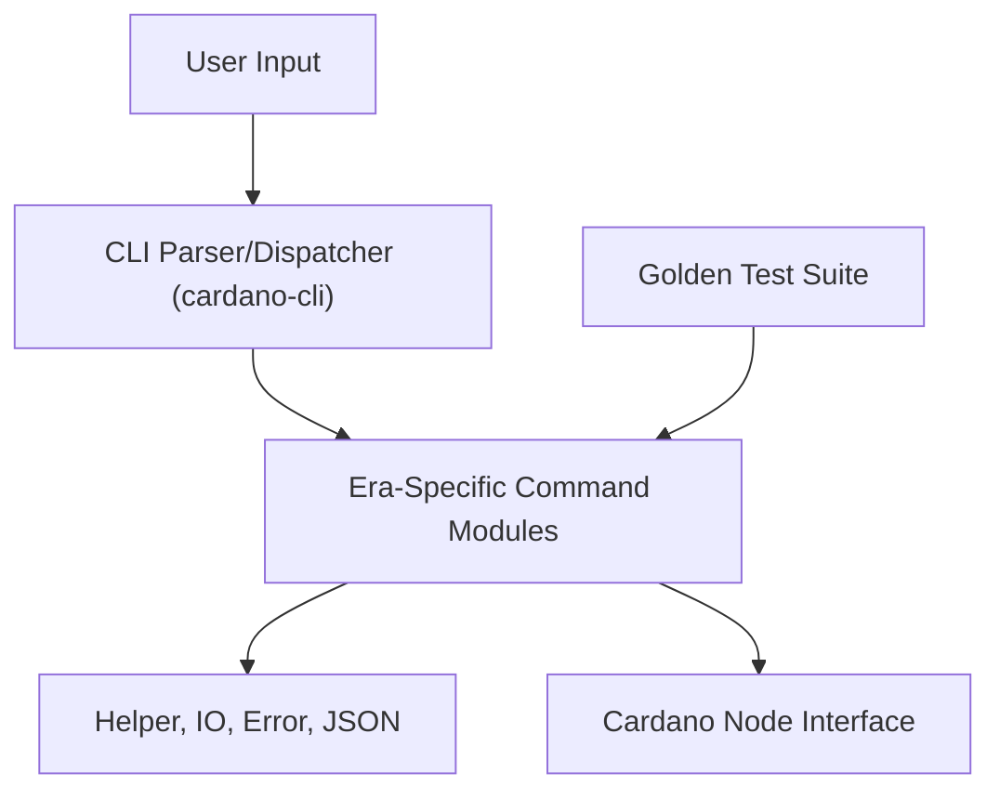

# IntersectMBO/cardano-cli

> Interface en ligne de commande pour interagir avec la blockchain Cardano, pour opérateurs et développeurs.

## Le problème
Gérer clés, transactions, délégation et gouvernance sur Cardano demande un outil officiel scriptable.

## Ce que ça fait vraiment
La CLI gère les clés de paiement et de stake, l'envoi d'ada, les stake pools, les DReps, la délégation et les requêtes sur la chaîne. Elle permet aussi d'interagir avec des scripts et de voter sur des actions de gouvernance. Le code, en Haskell, sépare les commandes par ère de protocole (Byron, EraBased, Compatible).

## Comment c'est branché


## Essayer
```bash
cat certificate.json | cardano-cli debug certificate view --certificate-file -
```

## Coût et pièges
Les binaires se téléchargent depuis les notes de version de cardano-node ou de cardano-cli, à choisir selon la version du nœud. Beaucoup de commandes supposent un cardano-node joignable.

## Ce que ce n'est pas
Ce n'est pas un portefeuille grand public ni un nœud : c'est un client de cardano-node. Le README renvoie la documentation de chaque commande à des sites externes.

## Alternatives
- Aucune alternative nommée dans le README.

## Pour toi
À ignorer : outil spécifique à Cardano, sans lien avec un profil data / IA / MLOps.

