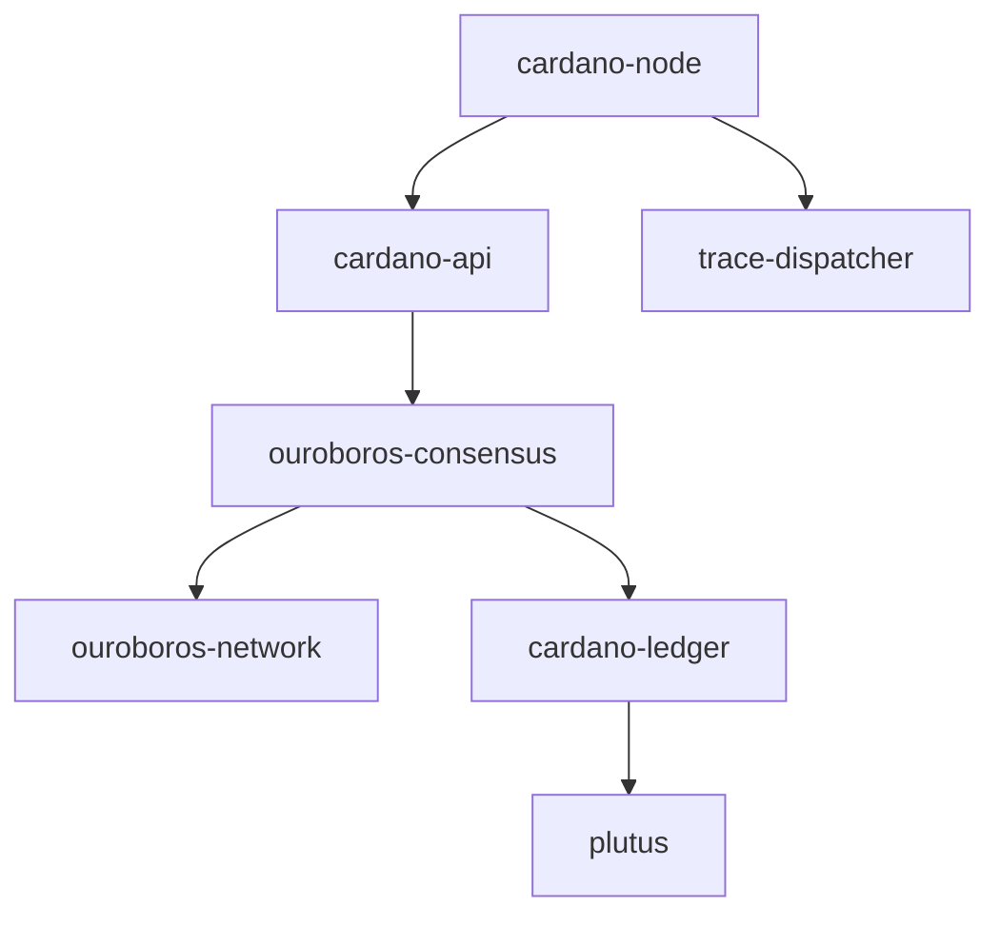

# IntersectMBO/cardano-node

> Haskell executable that integrates ledger, consensus and network to take part in the Cardano network.

## The problem
Taking part in the Cardano network requires assembling several components (ledger, consensus, network) into a single node.

## What it actually does
Integration point for the ledger, consensus and network layers; produces the `cardano-node` executable. According to the code diagram: configuration through YAML/JSON files (genesis, topology), IPC over sockets for external tools, tracing via cardano-tracer, Cabal/Nix and Docker builds. The README points to the Developer Portal for installation.

## How it is wired

## Trying it
No command documented in this README; installation and execution are described on the Cardano Developer Portal.

## Cost and gotchas
Heavy Haskell compilation; running a node requires disk, network and keeping up with per-network configurations.

## What it is not
Not a data science library nor a wallet: it is the blockchain node itself.

## Alternatives
No alternative named in the README.

## For you
Ignore: blockchain infrastructure with no direct link to a data/AI/MLOps pipeline.
