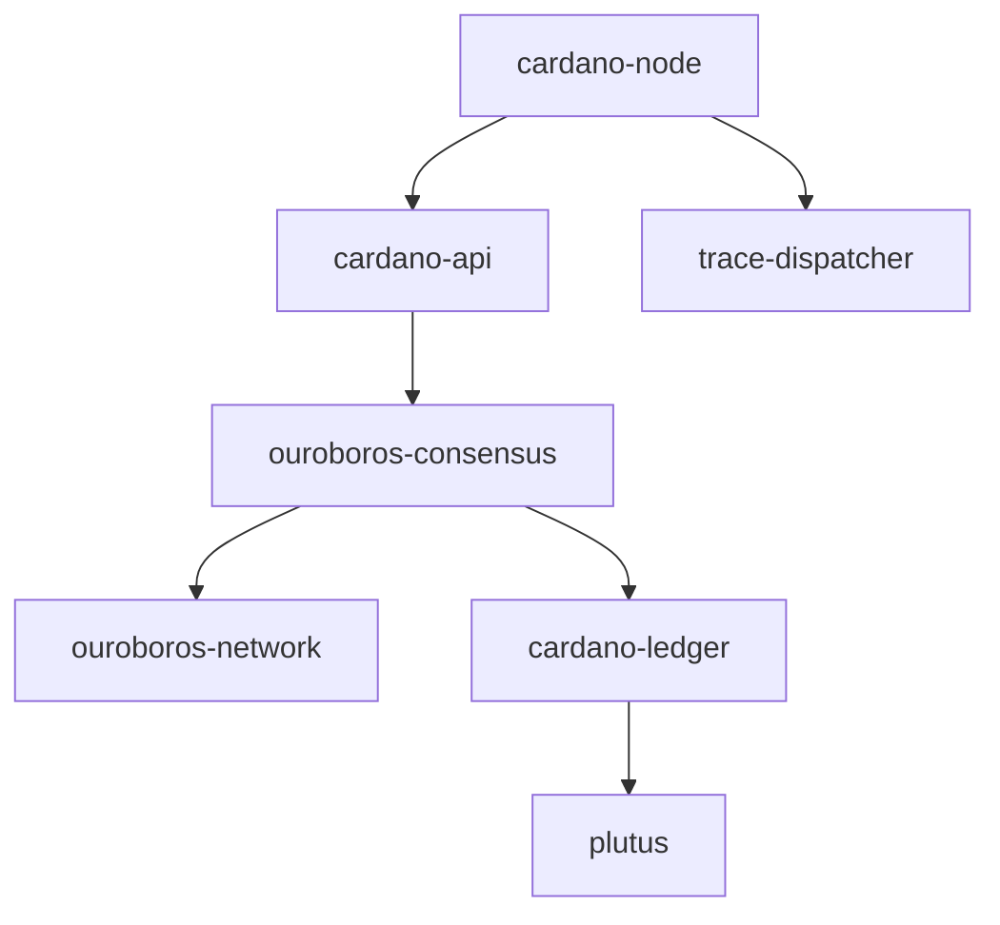

# IntersectMBO/cardano-node

> Exécutable Haskell qui intègre ledger, consensus et réseau pour participer au réseau Cardano.

## Le problème
Participer au réseau Cardano suppose d'assembler plusieurs composants (ledger, consensus, réseau) en un nœud unique.

## Ce que ça fait vraiment
Point d'intégration des couches ledger, consensus et réseau ; produit l'exécutable `cardano-node`. D'après le diagramme du code : configuration par fichiers YAML/JSON (genesis, topologie), IPC par sockets pour les outils externes, tracing via cardano-tracer, builds Cabal/Nix et Docker. Le README renvoie au Developer Portal pour l'installation.

## Comment c'est branché

## Essayer
Aucune commande documentée dans ce README ; l'installation et l'exécution sont décrites sur le Cardano Developer Portal.

## Coût et pièges
Compilation Haskell lourde ; exploiter un nœud demande disque, réseau et suivi des configurations par réseau.

## Ce que ce n'est pas
Pas une bibliothèque de data science ni un portefeuille : c'est le nœud de blockchain lui-même.

## Alternatives
Aucune alternative nommée dans le README.

## Pour toi
À ignorer : infrastructure blockchain sans lien direct avec un pipeline data/IA/MLOps.

