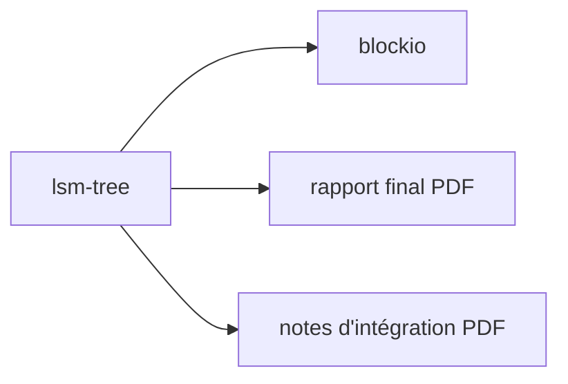

# IntersectMBO/lsm-tree

> Haskell LSM-tree library, developed by Well-Typed for Cardano; the README barely describes it.

## The problem
Not documented: the README does not say what problem the library solves.

## What it actually does
Not documented. The README only states that `lsm-tree` and its sibling package `blockio` were developed by Well-Typed LLP for the Cardano Development Foundation and Intersect, and points to a project report and integration notes in PDF format.

## How it is wired
Simplified diagram based on the sheet, no diagram provided.

## Trying it
No command documented in the README.

## Cost and gotchas
Haskell required (not in the prerequisites list, hence `none`). No licence is declared in the catalogue: reuse is legally uncertain.

## What it is not
It is not documented as a ready-to-use database engine: the README gives neither usage nor installation.

## Alternatives
No alternative named in the README.

## For you
Ignore: near-empty README, no declared licence, and a Haskell and Cardano ecosystem, far from a data, AI or MLOps profile.
