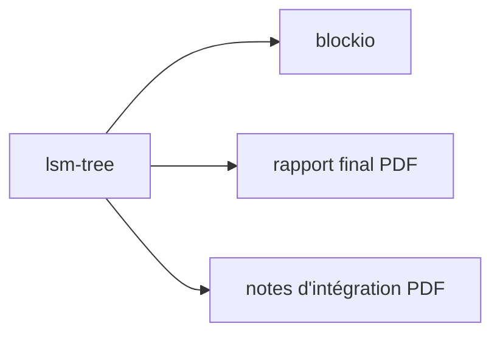

# IntersectMBO/lsm-tree

> Bibliothèque Haskell d'arbre LSM, développée par Well-Typed pour Cardano ; le README ne la décrit presque pas.

## Le problème
Non documenté : le README ne dit pas quel problème la bibliothèque résout.

## Ce que ça fait vraiment
Non documenté. Le README indique seulement que `lsm-tree` et son paquet fille `blockio` ont été développés par Well-Typed LLP pour la Cardano Development Foundation et Intersect, et renvoie à un rapport de projet et à des notes d'intégration au format PDF.

## Comment c'est branché
Schéma simplifié d'après la fiche, sans diagramme fourni.

## Essayer
Aucune commande documentée dans le README.

## Coût et pièges
Haskell requis (hors liste de prérequis, d'où `aucun`). Aucune licence n'est déclarée dans le catalogue : réutilisation juridiquement incertaine.

## Ce que ce n'est pas
Ce n'est pas documenté comme un moteur de base de données prêt à l'emploi : le README n'indique ni usage ni installation.

## Alternatives
Aucune alternative nommée dans le README.

## Pour toi
À ignorer : README quasi vide, pas de licence déclarée et écosystème Haskell et Cardano, loin d'un profil data, IA ou MLOps.

