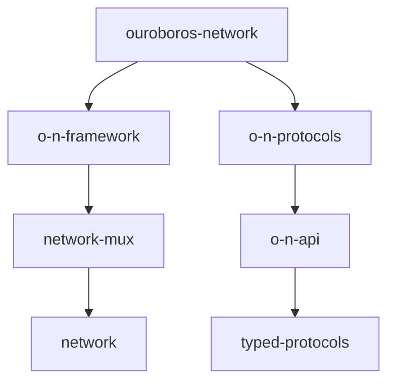

# IntersectMBO/ouroboros-network

> Specification and Haskell implementation of the network layer of the Ouroboros protocols, used by Cardano nodes.

## The problem
Nodes of the Cardano blockchain need a peer-to-peer network layer with multiplexing and typed protocols.

## What it actually does
A set of Haskell packages: multiplexer (`network-mux`), shared API, low-level framework (connection manager, handshake), node-to-node and node-to-client protocols, high-level integration with an outbound governor. Plus demos (chain-sync, ping-pong, mux, NTP).

## How it is wired


## Trying it
```bash
cabal run <DEMO_NAME> --
```

## Cost and gotchas
Haskell/cabal toolchain required. 362 open issues.

## What it is not
Not a full Cardano node: it is the network layer; consensus lives in another repository.

## Alternatives
No alternative named in the README.

## For you
Ignore: blockchain networking in Haskell, unrelated to data/AI/MLOps.
