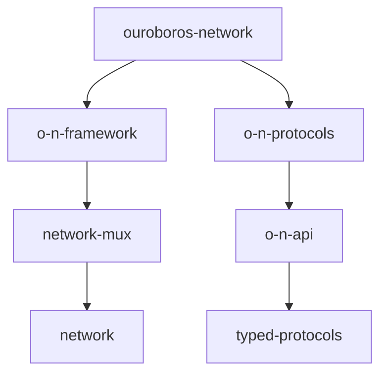

# IntersectMBO/ouroboros-network

> Spécification et implémentation Haskell de la couche réseau des protocoles Ouroboros, utilisée par les nœuds Cardano.

## Le problème
Les nœuds de la blockchain Cardano ont besoin d'une couche réseau pair-à-pair avec multiplexage et protocoles typés.

## Ce que ça fait vraiment
Un ensemble de paquets Haskell : multiplexeur (`network-mux`), API partagée, framework bas niveau (gestionnaire de connexions, handshake), protocoles node-to-node et node-to-client, intégration de haut niveau avec gouverneur sortant. Plus des démos (chain-sync, ping-pong, mux, NTP).

## Comment c'est branché


## Essayer
```bash
cabal run <DEMO_NAME> --
```

## Coût et pièges
Chaîne Haskell/cabal requise. 362 issues ouvertes.

## Ce que ce n'est pas
Pas un nœud Cardano complet : c'est la couche réseau ; le consensus est dans un autre dépôt.

## Alternatives
Aucune alternative nommée dans le README.

## Pour toi
À ignorer : réseau blockchain en Haskell, sans lien avec data/IA/MLOps.

