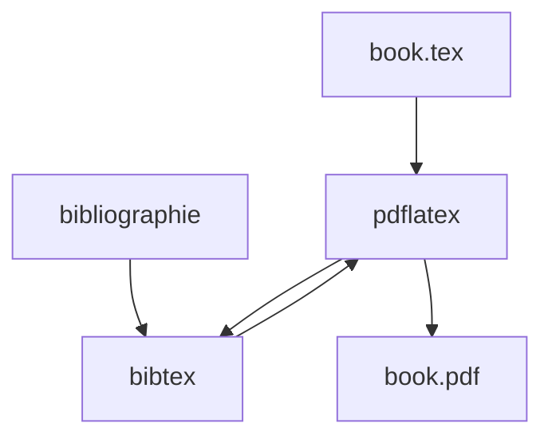

# Introduction-to-Autonomous-Robots/Introduction-to-Autonomous-Robots

> LaTeX sources of an open textbook on the computing principles of autonomous robots, for students.

## The problem
Learning the computing principles of autonomous robotics without going through a closed textbook.

## What it actually does
Contains the LaTeX source code of the book published by MIT Press. You compile the PDF yourself with `pdflatex` and `bibtex`, or via Overleaf. A ready-to-read PDF is not provided, for rights reasons.

## How it is wired
Simplified diagram based on the sheet, no diagram provided.


## Trying it
```bash
pdflatex -interaction=nonstopmode book.tex
bibtex book
pdflatex -interaction=nonstopmode book.tex
pdflatex -interaction=nonstopmode book.tex
```

## Cost and gotchas
Free. LaTeX with `pdflatex` and `bibtex` is required, plus ImageMagick for missing figures. The printed book is sold on Amazon.

## What it is not
Not robotics software code, but a book. CC BY-NC-ND license: non-commercial use, and publishing the compiled PDF is forbidden. GitHub does not identify it, hence the license check.

## Alternatives
No alternative named in the README.

## For you
Ignore: a robotics textbook, with no direct use in data / AI / MLOps, and whose license forbids redistributing the PDF.
