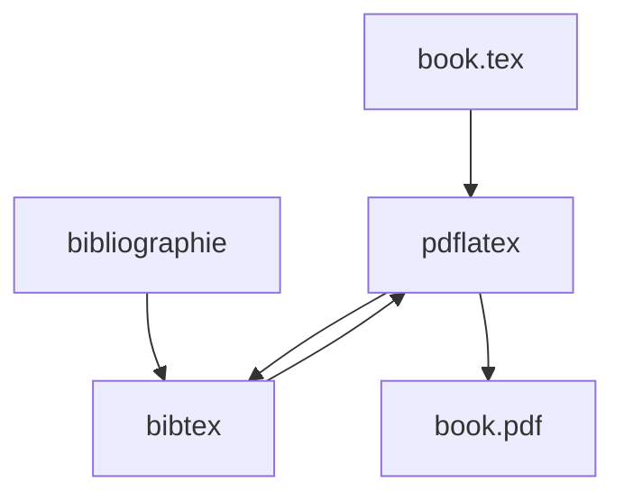

# Introduction-to-Autonomous-Robots/Introduction-to-Autonomous-Robots

> Sources LaTeX d'un manuel libre sur les principes de calcul des robots autonomes, pour étudiants.

## Le problème
Apprendre les principes de calcul de la robotique autonome sans passer par un manuel fermé.

## Ce que ça fait vraiment
Contient le code source LaTeX du livre publié chez MIT Press. Tu compiles toi-même le PDF avec `pdflatex` et `bibtex`, ou via Overleaf. Un PDF prêt à lire n'est pas fourni pour des raisons de droits.

## Comment c'est branché
Schéma simplifié d'après la fiche, sans diagramme fourni.


## Essayer
```bash
pdflatex -interaction=nonstopmode book.tex
bibtex book
pdflatex -interaction=nonstopmode book.tex
pdflatex -interaction=nonstopmode book.tex
```

## Coût et pièges
Gratuit. LaTeX avec `pdflatex` et `bibtex` requis, plus ImageMagick pour les figures manquantes. Le livre imprimé se vend sur Amazon.

## Ce que ce n'est pas
Pas un code logiciel de robotique, mais un livre. Licence CC BY-NC-ND : usage non commercial, et interdiction de publier le PDF compilé. GitHub ne l'identifie pas, d'où la vérification de licence.

## Alternatives
Aucune alternative nommée dans le README.

## Pour toi
À ignorer : un manuel de robotique, sans usage direct en data / IA / MLOps, et dont la licence interdit de redistribuer le PDF.

